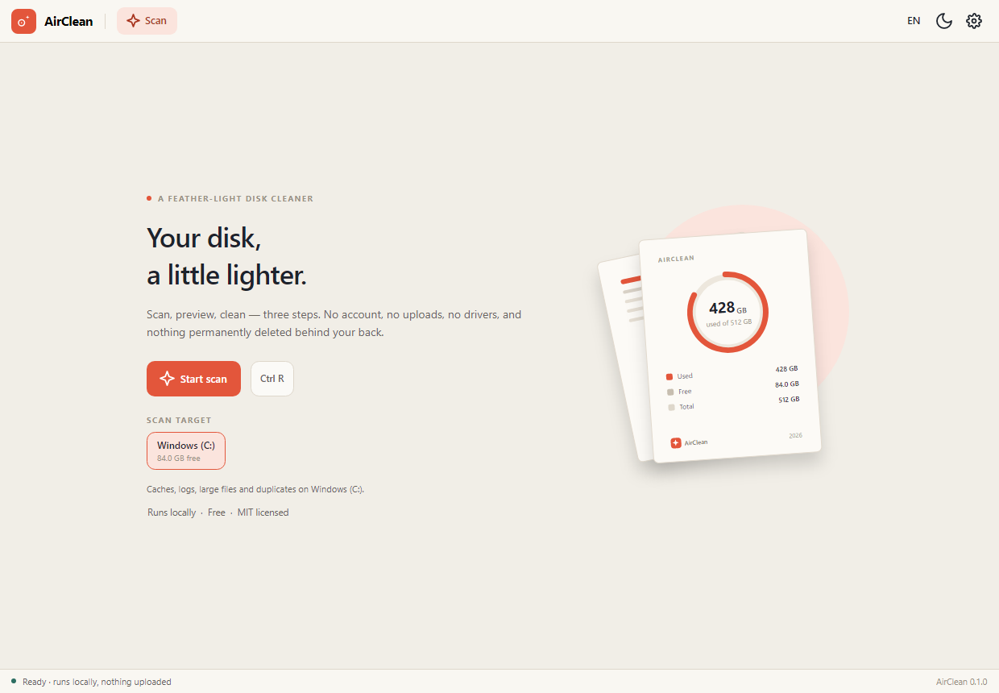
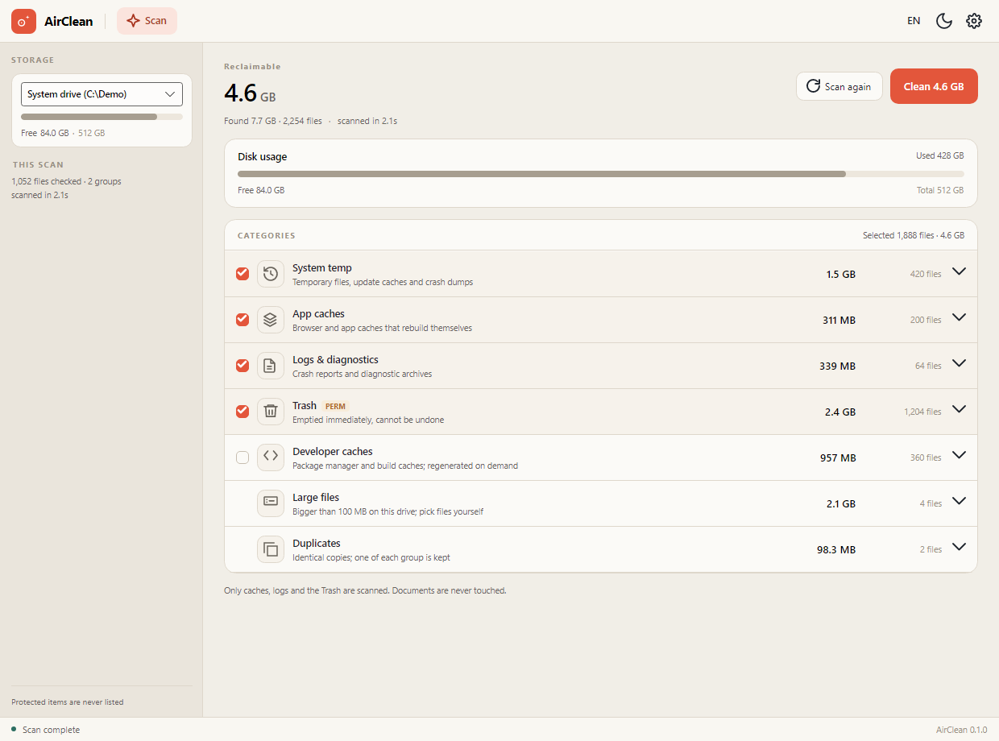
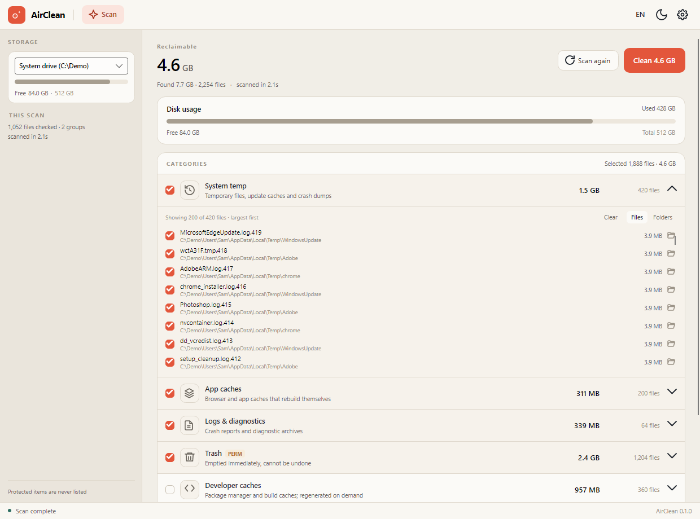
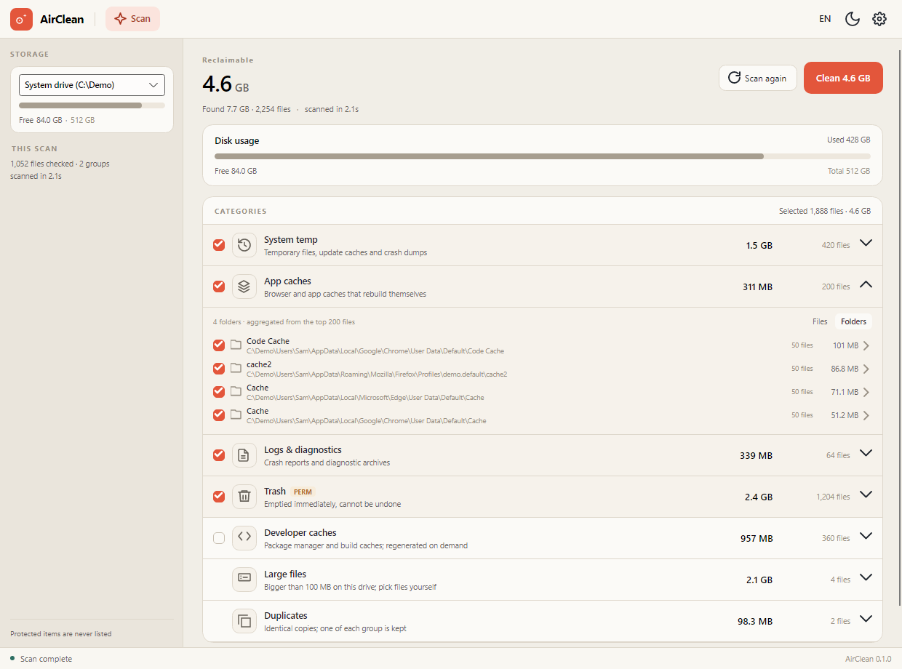
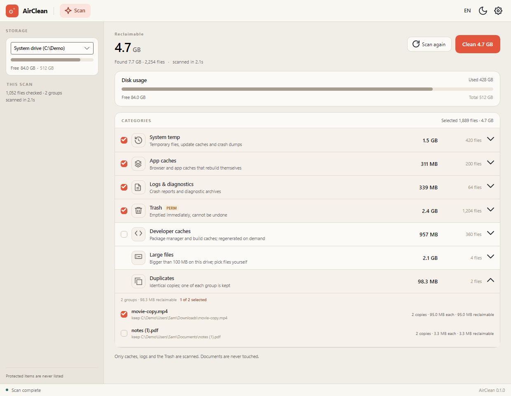
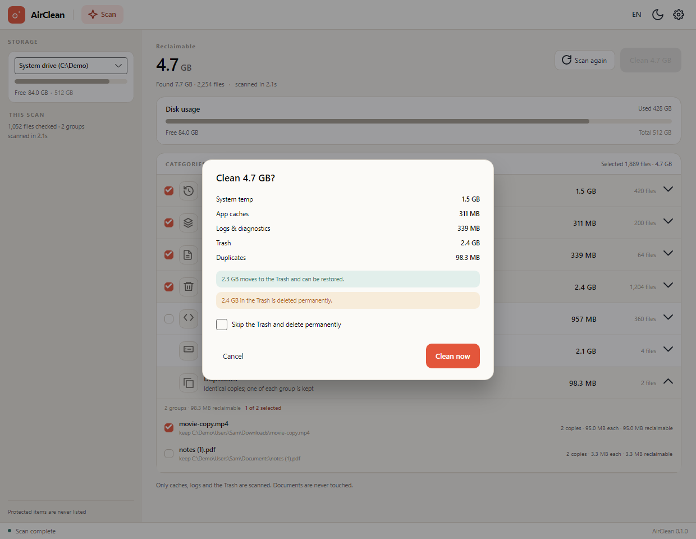
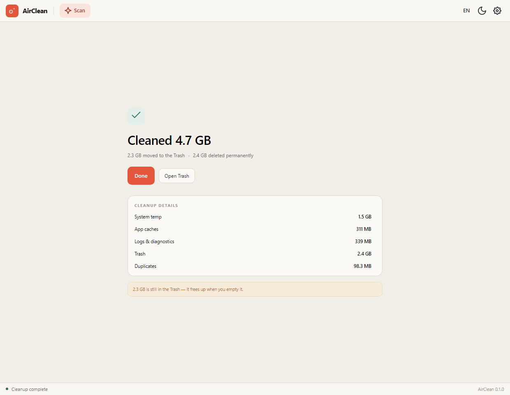
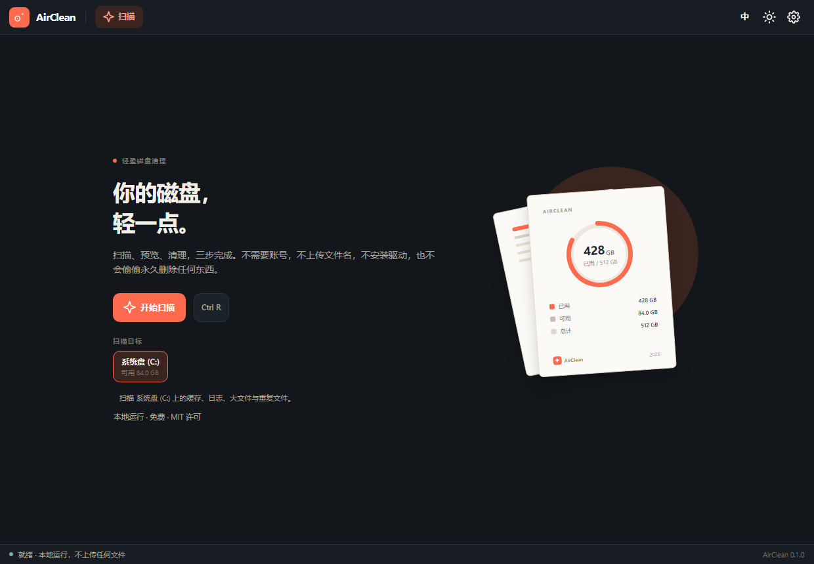
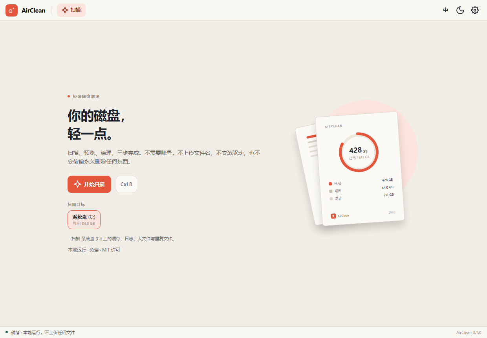

<p align="center">
  <a href="README.md">简体中文</a> &nbsp;·&nbsp; <strong>English</strong>
</p>

<p align="center">
  
</p>

<h1 align="center">AirClean</h1>

<p align="center">
  Your disk, a little lighter.<br />
  A free, offline, cross-platform disk cleaner built with .NET 10 and Avalonia 11.
</p>

<p align="center">
  <a href="https://github.com/RyzenWang/AirClean/actions/workflows/ci.yml">
    
  </a>
  
  
  
  
</p>

AirClean turns cleanup into three steps: **scan, preview, clean**. There is no
account, no cloud, no telemetry, and no permanent deletion behind your back. It
only touches caches and logs matched by rules, the system Trash, and the large
files or duplicate copies you tick yourself.

It is the second app in the Air series and shares its design language and stack
with [AirPDF](https://github.com/RyzenWang/AirPDF): the same warm paper
background, coral accent, quiet information density, and calm desktop presence.

> **Status:** 0.1 MVP. Scan, preview, and clean are wired end to end, with
> per-drive scanning and hand-picked large files. A benchmark on Windows scanned
> 22,000 files (7.4 GB total) in about 1.3 s. Screenshots use demo data.

---

## Screenshots



| Expanded details, deselect one file | Folders, select a whole folder |
| --- | --- |
|  |  |







| Dark theme | Simplified Chinese |
| --- | --- |
|  |  |

## Features

### Scanning

- **Pick the drive up front.** The welcome page lists mounted volumes with their
  free space and starts on the system drive. Choose one, then press **Start scan**.
  The selector in the results sidebar can switch drives and rescan once a scan is
  no longer running.
- **One scan, every applicable category.** There is no separate "find
  duplicates" mode. A system drive scan runs cache rules, large files, the Trash,
  and duplicates; a data drive scan runs large files, the Trash, and duplicates.
- **Results arrive in stages.** Caches land first (in a second or two), large
  files and duplicates follow. Categories still running say **Waiting…**, so the
  window is useful before everything finishes.
- **Real numbers.** Category sizes and file counts come from the actual walk, not
  estimates, and are never double-counted.
- **NTFS MFT fast path.** On Windows NTFS with administrator access (or with
  administrator acceleration enabled in settings), AirClean reads the master file
  table instead of walking directories. Without elevation it falls back to the
  normal walk. On a Windows runner, a 1.4 GB MFT with 1.36 million records took
  about 9 s (8 s read, 0.7 s parse, 0.2 s index).
- **Administrator acceleration.** When enabled, large-file scans launch a read-only
  `--admin-helper` child through UAC and receive the MFT result over a named pipe.
  Declining UAC or lacking permission falls back automatically. The main process
  never elevates, and the helper only accepts a drive root, never a path list.
- **Stop any time.** Cancelling a scan stops it immediately and returns to the
  welcome page without touching any files.

### Preview and pick

- **Large files, one by one.** The 200 largest files of at least 100 MB on the
  drive are listed with nothing selected. The header total only counts what you
  tick.
- **Duplicates.** Files of at least 1 MB are bucketed by exact size, compared by
  their first 64 KB, then hashed with SHA-256. The oldest copy of each group is
  kept, and nothing is selected by default.
- **Select all, or select a folder.** The detail header has **Select all** and
  **Clear** actions for the visible list. In **Folders** view, a folder checkbox
  selects every file directly inside it; empty folders are pruned after cleanup.
- **Exclude individual files.** Expand a normal category and untick any row. The
  category becomes indeterminate, and both the header total and the **Clean**
  button drop by that file. Files outside the preview still follow the category
  state.
- **Group by folder.** Switch the detail view between **Files** and **Folders**.
  Folders are sorted by size; clicking one drills into its files and adds a
  removable filter chip at the top.
- **Expandable details.** Click a category row or its arrow to inspect the files
  in place: name, containing folder, and size, largest first, up to 200 rows with
  the total count shown when there are more.
- **Show in folder.** The folder icon at the end of a row reveals the file in the
  system file manager (`/select` on Windows, `open -R` on macOS).

### Cleaning and safety

- **Visible, cancellable cleanup.** After confirmation, the dialog becomes a
  progress view with a spinner, processed/total counts, a percentage bar, and the
  current path. **Stop** halts the batch and reports exactly what was processed.
- **Trash by default.** Every cleanup starts with a confirmation dialog.
  Permanent deletion only happens when you explicitly tick **Skip the Trash and
  delete permanently**.
- **The Trash is separate.** Emptying it is permanent, so the confirmation dialog
  calls it out separately instead of folding it into a normal delete.
- **Re-check before delete.** Every item is verified again: still under its rule
  root, outside the protected list, unchanged in size and modification time, not
  in use, and not a link. Anything that fails is skipped with a reason.
- **A local journal.** Every batch writes one JSONL line to the per-user app data
  folder (`%APPDATA%\AirClean\journal` on Windows), with paths and sizes only.
- **Offline.** No account, no ads, no telemetry. Installed builds contact GitHub
  only to check for updates.

### Look and updates

- **Two languages, three themes.** Switch between English and Simplified Chinese
  live, and choose light, dark, or follow-system.
- **Automatic updates for installed builds.** The app checks for a stable
  release, downloads it in the background, and offers **Restart to update**.
  Portable and source builds never self-update.

## Tech stack

| Layer | Choice | Why |
| --- | --- | --- |
| Runtime | .NET 10 (LTS) | One modern runtime for Windows, macOS, and Linux. |
| UI | Avalonia 11 | Native desktop windows from one XAML codebase, with high-DPI support. |
| MVVM | CommunityToolkit.Mvvm | Small, source-generated, no framework lock-in. |
| Packaging | Velopack | Installers, portable packages, and automatic updates. |
| Tests | xUnit + Avalonia.Headless | Core unit tests plus off-screen rendering of the real windows. |

## Requirements

- [.NET 10 SDK](https://dotnet.microsoft.com/download) for building.
- Windows 10/11, macOS 13+, or a modern Linux desktop (X11 or Wayland).
- On Linux, the usual Avalonia desktop dependencies are required: X11/Wayland,
  fontconfig, and OpenGL or a software renderer. A CJK font is needed to render
  the Chinese UI.

Published builds are self-contained; end users do not need .NET installed.

## Run from source

```bash
git clone https://github.com/RyzenWang/AirClean.git
cd AirClean
dotnet run --project src/AirClean.App
```

Pick a drive on the welcome screen and press **Start scan**. No extra arguments
or configuration files are needed.

## Build and test

```bash
dotnet restore AirClean.sln
dotnet build AirClean.sln -c Release
dotnet test AirClean.sln -c Release
```

There are 49 Core tests and 15 Avalonia Headless tests. They cover rule
validation, path guards, the scanners, MFT record parsing, privileged-scan
fallback, large-file scanning, duplicate grouping, tri-state selection and
per-item filtering, folder aggregation, deletion and the journal, plus three full
flows: **scan → confirm → complete**,
**switch drive → pick a large file**, and **find duplicates → select a group**.
Headless tests
write rendered frames to `%TEMP%/airclean-shots`.

CI runs restore, build, and test on Ubuntu, Windows, and macOS.

## Controls and shortcuts

| Action | How |
| --- | --- |
| Start or rescan | `Ctrl+R`, or the scan button in the toolbar or results page |
| Cancel a scan | `Esc`, or the cancel button on the scanning page |
| Close the confirmation dialog | `Esc`, or **Cancel** |
| Expand or collapse a category | Click the row or its arrow |
| Switch between files and folders | **Files / Folders** in the detail header |
| Show a file in its folder | The folder icon at the end of the row |
| Switch language | The language button in the toolbar (中 / EN) |
| Switch theme | The moon / sun button in the toolbar |
| Open settings | The gear button in the toolbar |

## Architecture

```
┌──────────────────────────────────────────────┐
│ AirClean.App · Avalonia                      │
│ views · view models · localization · theme   │
└──────────────────────┬───────────────────────┘
                       │
┌──────────────────────▼───────────────────────┐
│ AirClean.Core                                │
│ rules · scanners · path guard · deletion     │
└──────────────────────┬───────────────────────┘
                       │
┌──────────────────────▼───────────────────────┐
│ AirClean.Platform                            │
│ Recycle Bin · Trash · freedesktop · reveal   │
└──────────────────────────────────────────────┘
```

- `AirClean.Core` has no Avalonia dependency and can be reused by a CLI, tests,
  or another front end.
- Rules are embedded JSON, one set per platform. Before scanning, environment
  variables are expanded and every root passes the path guard.
- The three scan stages publish results to the UI as they finish, and every stage
  is cancellable. The scanners report only what they actually walked.
- Deletion re-checks root containment, the protected list, size, modification
  time, and link status for every item; failures become skip reasons.
- Trash and reveal are platform adapters; automatic updates only exist in the
  Velopack-installed build.

More detail: [docs/DESIGN.md](docs/DESIGN.md).

## Project layout

```
src/
  AirClean.Core/          UI-free rules, scanners, path guard, deletion, journal
    Rules/                Embedded JSON rules (windows / macos / linux)
    Scanning/             Walk, dedupe, MFT, age/depth filters, progress, large files
    Security/             PathGuard and path expansion
    Volumes/              Drive enumeration
    Deleting/             DeletionService and journal
  AirClean.Platform/      Recycle Bin, Trash, and the administrator helper
  AirClean.App/           Avalonia UI: welcome, scanning, results, confirm, done
tests/
  AirClean.Core.Tests/    49 tests
  AirClean.App.Tests/     15 headless rendering and flow tests
tools/
  MftCheck/               Elevated MFT scan and helper round-trip check
docs/
  DESIGN.md               Product, visual, and technical design
  DISTRIBUTION.md         Packaging, signing, and automatic updates
  screens/                README screenshots
  design/                 Visual mockups
```

## Install and release

```bash
git tag v0.1.0
git push origin v0.1.0
```

Tagged releases are packaged with [Velopack](https://velopack.io/):

- Windows x64: `AirClean-win-Setup.exe` installer and a portable zip
- macOS arm64 / x64: `AirClean-osx-*.pkg` installer and a portable package
- Linux x64: portable `.tar.gz`

Installed builds check GitHub for a newer stable release, download it in the
background, and show **Restart to update**. Portable and source builds do not
self-update. A tag containing `-preview` is marked as a pre-release and is never
offered by the in-app updater.

Signing and notarization secrets are documented in
[docs/DISTRIBUTION.md](docs/DISTRIBUTION.md). Without them the workflow still
produces unsigned packages, which Windows SmartScreen and macOS Gatekeeper will
challenge. The **Release** workflow can also be run manually to build and upload
artifacts without creating a release.

## Safety model

Deletion only ever happens to **items that were scanned**, and every item must
pass again at delete time: it is still under its rule root, outside the protected
list, unchanged in size and modification time, and not a link. If any check
fails, the item is skipped and the reason is shown on the completion page.

A rule root that points at a system directory, the user's documents, `~/.ssh`,
and similar locations is rejected during the scan. Files go to the system Trash
by default; permanent deletion requires an explicit opt-in; emptying the Trash is
a separate action and is labelled as irreversible. Each batch writes a local
JSONL journal with paths and sizes only.

## Limitations

- No startup manager, scheduled reminders, tray icon, or full settings page yet
  (settings currently cover theme, language, and the administrator toggle).
- Duplicates on the system volume scan the user's content folders only; data
  drives are scanned whole. There is no incremental index, so every run hashes
  files again, and data drives have a 2 GB hashing cap (the UI says when the cap
  is hit). Hard links are not deduplicated.
- No administrator-only categories yet (Windows Update cache,
  `/var/cache/apt`, `journald`); the helper currently performs read-only MFT scans
  only, not system-level cleanup.
- Large-file scanning prefers the NTFS MFT. That path needs administrator access
  (there is no elevation helper yet); without it AirClean falls back to walking
  the whole drive, which can take minutes on a cold mechanical drive (progress
  and cancellation are available).
- No true "undo" on Windows yet; the completion page can open the Recycle Bin,
  and macOS/Linux hand files to the system Trash.
- macOS and Linux have not been verified on real hardware. The CI matrix is in
  place and volume enumeration branches per platform.
- Windows signing and Apple notarization have not been run with real
  certificates; unsigned packages trigger the usual platform warnings.

## Roadmap

Status: ✅ Done · 🚧 In progress · ⬜ Not started. Currently **9 done, 3 in progress, 6 not started**.

| Status | Item | Notes |
| --- | --- | --- |
| ✅ Done | Volume-aware scanning with streamed results | One scan covers caches, large files, the Trash, and duplicates; categories appear as they finish. |
| ✅ Done | Hand-picked large files | Top 200 files of at least 100 MB, nothing selected by default. |
| ✅ Done | Duplicate groups with explicit selection | Size bucket → first 64 KB → SHA-256; one copy kept per group. |
| ✅ Done | Tri-state selection, folder aggregation, per-item exclusion | Includes indeterminate categories and whole-folder selection. |
| ✅ Done | Cleanup progress, cancellation, Trash, and a local journal | Cancellable progress, Trash by default, a JSONL journal per batch. |
| ✅ Done | English / Simplified Chinese and light / dark themes | Live switching, including follow-system. |
| ✅ Done | Windows installer, macOS pkg, Linux portable build | Velopack packaging is wired up. |
| ✅ Done | Auto-update on installed Windows / macOS builds | Background check/download with a restart prompt. |
| ✅ Done | MFT-based large-file scanning | Validated on a Windows runner: a 1.4 GB MFT with 1.36 million records took about 9 s. It needs administrator access; the normal walk is the fallback. |
| 🚧 In progress | Production signing and notarization | Workflow and secrets docs are ready; no real certificates yet, so Windows signing and Apple notarization have not been exercised. |
| 🚧 In progress | macOS / Linux hardware validation | CI covers builds and headless tests on all three platforms; real-hardware checks for the UI, themes, Trash, and reveal are still missing. |
| 🚧 In progress | Administrator-only categories | The elevation helper and MFT acceleration are in place and round-trip tested; Windows Update / apt / journald cleanup rules are not wired yet. |
| ⬜ Not started | A real "undo the last cleanup" | The completion page can only open the Recycle Bin / Trash; batch tracking and restore are missing. |
| ⬜ Not started | Tray icon and background mode | Keep running after the window closes, tray menu, and a quick-scan entry. |
| ⬜ Not started | Scheduled reminders | Daily / weekly reminders, off by default, no automatic deletion. |
| ⬜ Not started | Full settings page | The current flyout only has theme, language, and the administrator toggle; scan scope, exclusions, delete mode, and updates are missing. |
| ⬜ Not started | Windows arm64 artifacts | The release matrix only has `win-x64`. |
| ⬜ Not started | linux-arm64 artifacts | The release matrix only has `linux-x64`. |

## Contributing

Issues and pull requests are welcome. Before opening a PR, run
`dotnet build AirClean.sln` and `dotnet test AirClean.sln`. A few conventions:

- `AirClean.Core` stays free of Avalonia; UI logic belongs in `AirClean.App`.
- A new cleanup rule must come with path-guard handling, age/depth filters, and
  tests.
- UI changes should include a headless screenshot and a note on light and dark
  themes.
- Please do not post exploitable details of security issues in a public issue.

## Documentation

| Document | Contents |
| --- | --- |
| [docs/DESIGN.md](docs/DESIGN.md) | Product positioning, information architecture, visual rules, technical design, safety model, milestones |
| [docs/DISTRIBUTION.md](docs/DISTRIBUTION.md) | Packaging, signing, notarization, and in-app updates |
| [docs/design/mockup.png](docs/design/mockup.png) | Visual mockups for the three key screens |

## Three rules we won't break

1. **Trash by default.** Permanent deletion is always an explicit opt-in.
2. **Delete less, explain more.** Skipped items must say why, and reclaimable
   totals are never double-counted.
3. **No network.** No account, no ads, no telemetry; only installed builds check
   GitHub for updates.

## License

AirClean is released under the [MIT License](LICENSE).

---

<sub>Also available in [简体中文](README.md).</sub>
