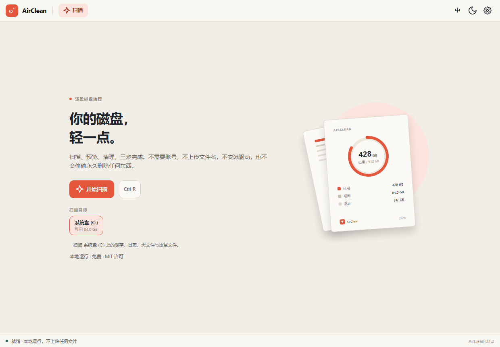
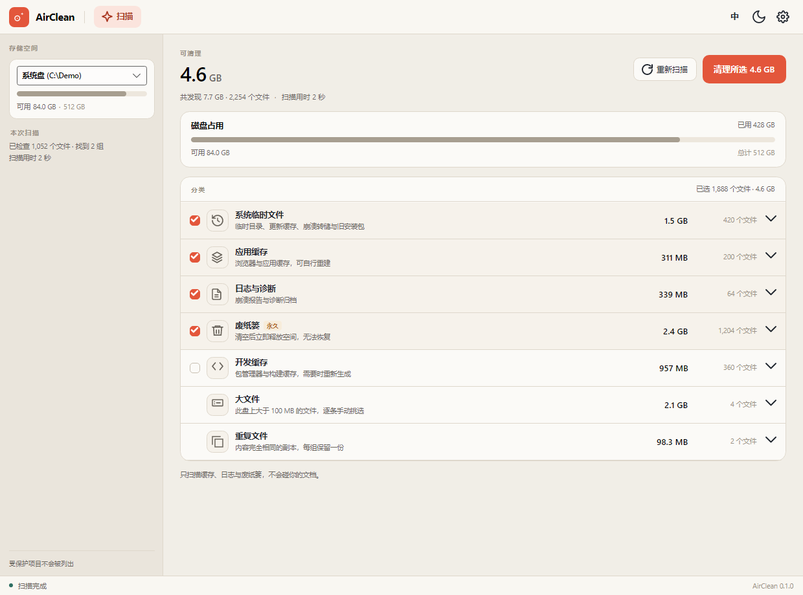
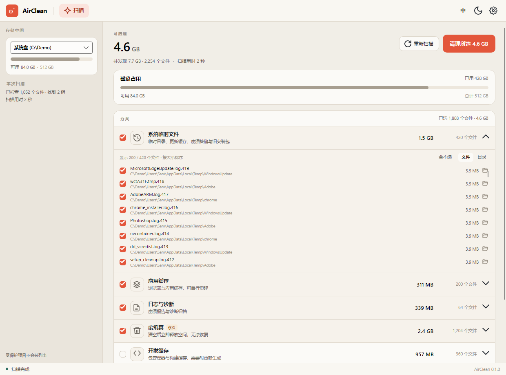
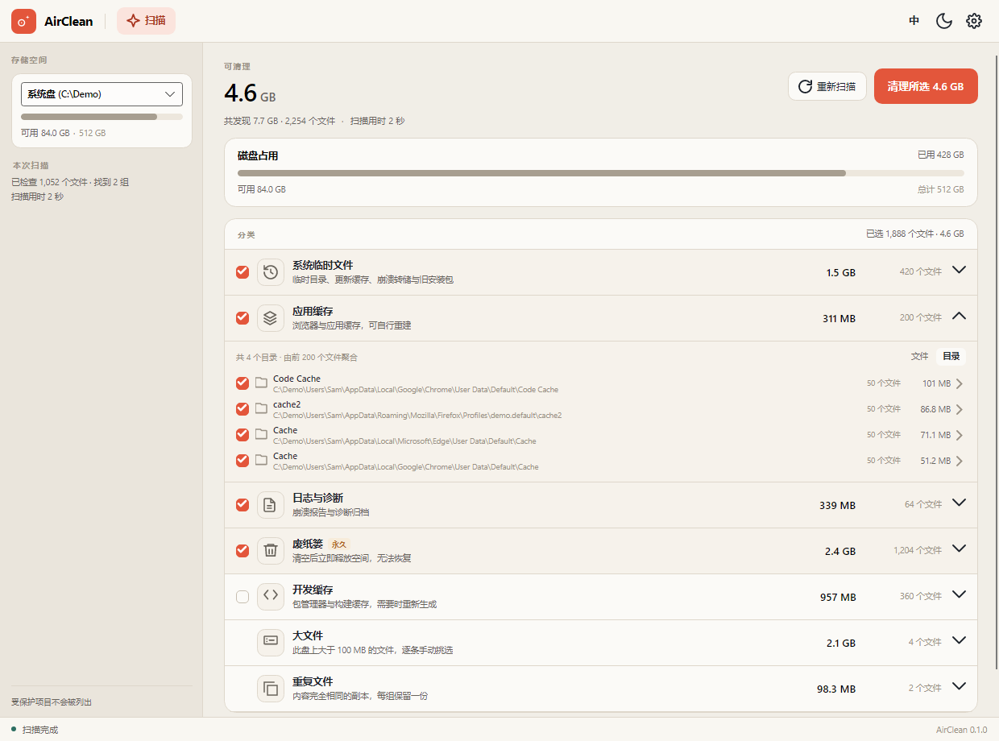
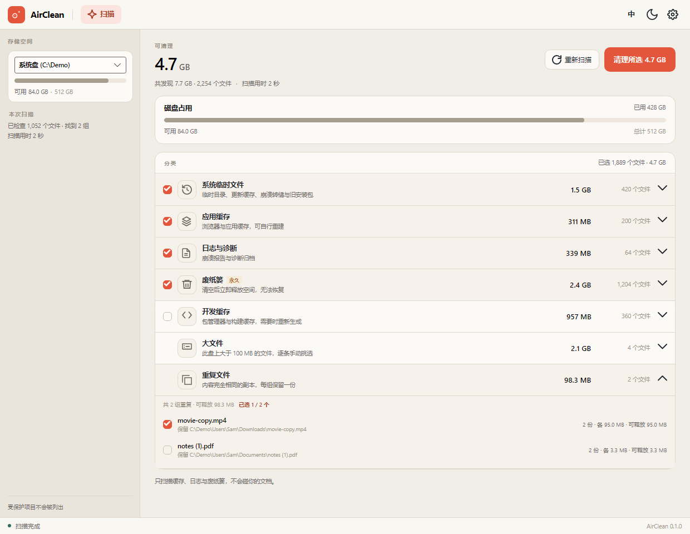
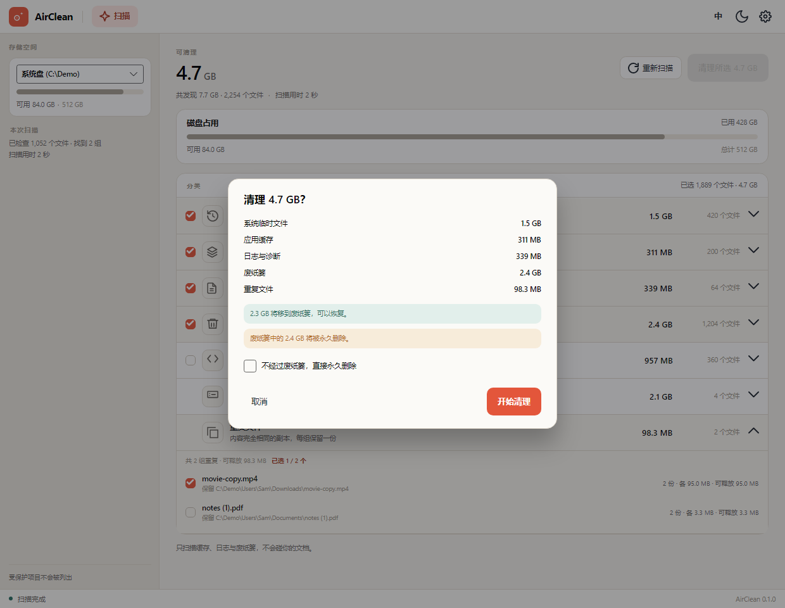
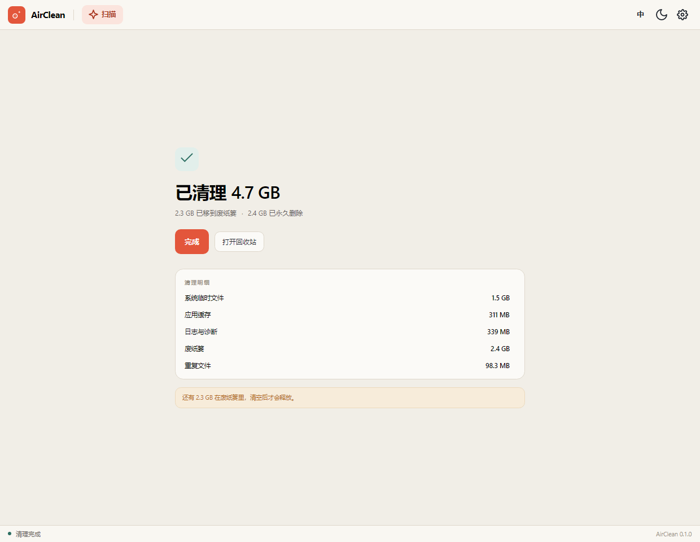
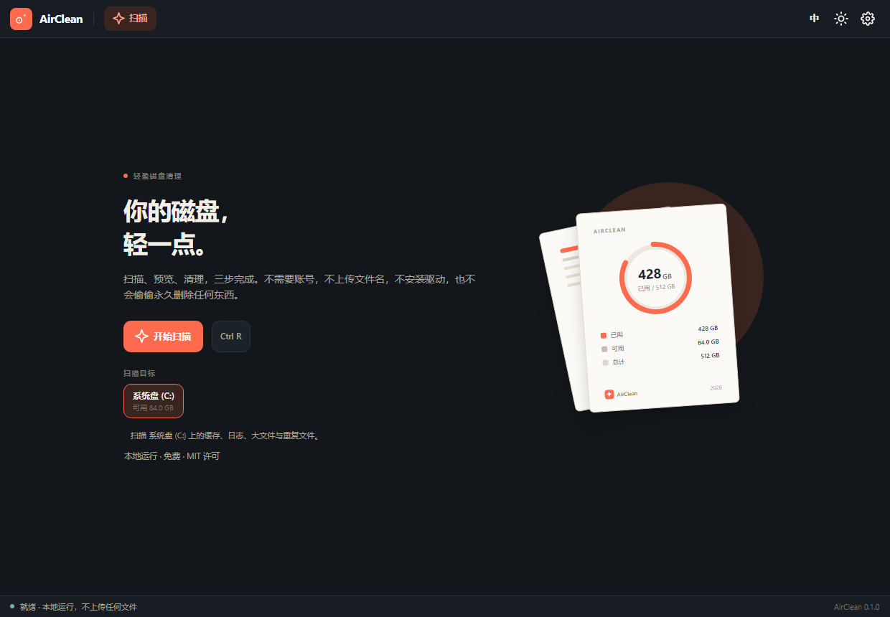
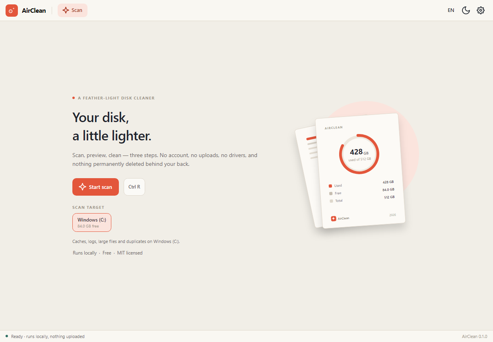

<p align="center">
  <strong>简体中文</strong> &nbsp;·&nbsp; <a href="README.en.md">English</a>
</p>

<p align="center">
  
</p>

<h1 align="center">AirClean</h1>

<p align="center">
  你的磁盘，轻一点。<br />
  免费、离线、跨平台的磁盘清理工具，使用 .NET 10 与 Avalonia 11 构建。
</p>

<p align="center">
  <a href="https://github.com/RyzenWang/AirClean/actions/workflows/ci.yml">
    
  </a>
  
  
  
  
</p>

AirClean 把清理拆成三步：**扫描、预览、清理**。没有账号，没有云端，没有遥测，
也不会绕过你偷偷永久删除任何东西。它只处理规则命中的缓存、日志、废纸篓，
以及你亲手勾选的大文件和重复副本。

它是 Air 系列的第二款产品，与 [AirPDF](https://github.com/RyzenWang/AirPDF)
共用一套设计语言和技术栈：暖纸底、珊瑚红、克制的信息密度，以及同样安静的桌面体验。

> **状态：** 0.1 MVP。扫描、预览、清理已经打通，支持切换磁盘与逐条挑选大文件。
> Windows 上实测扫描 2.2 万个文件（共 7.4 GB）用时约 1.3 秒。截图使用演示数据。

---

## 截图



| 展开明细，逐条取消勾选 | 按目录聚合，整目录勾选 |
| --- | --- |
|  |  |







| 深色主题 | English UI |
| --- | --- |
|  |  |

## 功能

### 扫描

- **入口就能选盘**：欢迎页列出本机磁盘（名称 + 可用空间），默认选中系统盘；
  选完再点“开始扫描”，扫的就是这块盘。结果页左栏的下拉框可以换盘并重扫
  （扫描进行中不可切换）。
- **一次扫描出全部结果**：没有单独的“查重复”入口。扫一块盘就跑完所有适用分类——
  系统盘上跑缓存规则、大文件、废纸篓、重复文件；数据盘上跑大文件、废纸篓、重复文件。
- **分阶段出结果**：缓存先出来（1–2 秒），大文件和重复文件随后补上；正在跑的类别
  显示“等待中…”，不用等全部算完。
- **真实体积**：边扫边出结果，分类体积与文件数都来自实际遍历，不估算、不重复相加。
- **NTFS MFT 快扫**：Windows + NTFS 且以管理员身份运行时，直接读取主文件表，
  不再逐目录遍历；普通权限会自动回退到整盘遍历。Windows runner 上以 1.4 GB MFT /
  136 万条记录实测约 9 秒（读取约 8 秒、解析 0.7 秒、建索引 0.2 秒）。
- **可随时停止**：扫描中取消会立即停下并回到欢迎页，不触碰任何文件。

### 预览与挑选

- **大文件逐条挑选**：列出该盘最大的 200 个 ≥100 MB 文件，默认一个都不选；
  勾哪个删哪个，头部数字只算你勾的。
- **重复文件**：内容完全相同的文件（≥1 MB），先按大小分桶、再比首 64 KB、
  最后整文件 SHA-256；每组保留最早的一份，默认一个都不选。
- **全选与整目录勾选**：明细头部有“全选 / 全不选”，作用于当前列表；切到“目录”视图后，
  每个目录前有勾选框，勾一下就是该目录下的文件；清理后空目录会一并移除。
- **逐条排除**：普通分类展开后，每个文件都有勾选框。取消一个，分类变成半选（横杠），
  头部体积和“清理所选”同步减掉；没列出的文件仍按分类状态处理。
- **按目录聚合**：明细可切换“文件 / 目录”，目录按体积排序；点一个目录就下钻成
  该目录下的文件，顶部出现可清除的筛选条。
- **可展开明细**：点分类行或右侧箭头，就地展开该分类的文件列表（按大小排序，
  显示文件名、所在目录、体积；最多 200 条，超出部分注明总数）。
- **在文件夹中显示**：明细行尾的文件夹图标直接定位到该文件
  （Windows 用 `/select`，macOS 用 `open -R`）。

### 清理与安全

- **清理过程可见可中止**：确认后弹层切换成进度视图——旋转指示器、`已处理/总数`、
  百分比进度条、当前文件路径，随时可以“停止”；中止后如实报告已处理的部分。
- **默认进废纸篓**：清理前有确认弹层；勾选“直接永久删除”才会绕过废纸篓。
- **废纸篓单独处理**：它是永久清空，确认弹层会单独说明，不会混在普通删除里。
- **删前复检**：路径越界、受保护目录、扫描后被修改、正在占用、符号链接，全部跳过
  并给出原因。
- **本地日志**：每批清理写一条 JSONL（Windows 为 `%APPDATA%\AirClean\journal`，
  macOS/Linux 在用户配置目录下），只记路径与体积。
- **不联网**：无账号、无广告、无遥测；只有安装版检查更新时访问 GitHub。

### 外观与更新

- **双语与主题**：中英文即时切换，浅色 / 深色 / 跟随系统。
- **安装版自动更新**：后台检查并下载新版本，状态栏出现“重启以更新”；
  便携版与源码运行不会自更新。

## 技术栈

| 层 | 选择 | 说明 |
| --- | --- | --- |
| 运行时 | .NET 10 (LTS) | 一个现代运行时覆盖 Windows、macOS 与 Linux。 |
| 界面 | Avalonia 11 | 一套 XAML 代码生成原生桌面窗口，支持高 DPI。 |
| MVVM | CommunityToolkit.Mvvm | 小而克制的源生成 MVVM，不绑定框架。 |
| 分发 | Velopack | 安装器、便携包与安装版自动更新。 |
| 测试 | xUnit + Avalonia.Headless | 核心逻辑单测，加上真实窗口的离屏渲染测试。 |

## 环境要求

- 构建需要 [.NET 10 SDK](https://dotnet.microsoft.com/download)。
- Windows 10/11、macOS 13+，或现代 Linux 桌面（X11 / Wayland）。
- Linux 需要常见的 Avalonia 桌面依赖：X11/Wayland、fontconfig，以及 OpenGL
  或软件渲染；显示中文界面还需要系统安装 CJK 字体。

发布包是自包含的，最终用户不需要预装 .NET。

## 从源码运行

```bash
git clone https://github.com/RyzenWang/AirClean.git
cd AirClean
dotnet run --project src/AirClean.App
```

启动后在欢迎页选一块盘，点“开始扫描”。没有额外参数或配置文件需要准备。

## 构建与测试

```bash
dotnet restore AirClean.sln
dotnet build AirClean.sln -c Release
dotnet test AirClean.sln -c Release
```

48 个 Core 测试与 15 个 Avalonia Headless 测试，覆盖规则校验、路径守卫、扫描器、
MFT 记录解析、大文件扫描、重复文件分组、三态勾选与按条目过滤、目录聚合、删除与日志，
以及“扫描 → 确认 → 完成”、“切换磁盘 → 勾选大文件”、“查找重复 → 勾选整组”三条链路。
Headless 测试会把渲染截图写到 `%TEMP%/airclean-shots`。

CI 在 Ubuntu、Windows 与 macOS 三平台上执行 restore、build 和 test。

## 操作与快捷键

| 操作 | 方式 |
| --- | --- |
| 开始 / 重新扫描 | `Ctrl+R`，或顶栏、结果页的扫描按钮 |
| 取消扫描 | `Esc`，或扫描页的取消按钮 |
| 关闭确认弹层 | `Esc`，或“取消” |
| 展开 / 收起分类 | 点击分类行，或行尾箭头 |
| 切换文件 / 目录视图 | 明细头部的“文件 / 目录” |
| 在文件夹中显示 | 明细行尾的文件夹图标 |
| 切换语言 | 顶栏语言按钮（中 / EN） |
| 切换主题 | 顶栏月亮 / 太阳按钮 |
| 打开设置 | 顶栏齿轮按钮 |

## 架构

```
┌──────────────────────────────────────────────┐
│ AirClean.App · Avalonia                      │
│ views · view models · localization · theme   │
└──────────────────────┬───────────────────────┘
                       │
┌──────────────────────▼───────────────────────┐
│ AirClean.Core                                │
│ rules · scanners · path guard · deletion     │
└──────────────────────┬───────────────────────┘
                       │
┌──────────────────────▼───────────────────────┐
│ AirClean.Platform                            │
│ Recycle Bin · Trash · freedesktop · reveal   │
└──────────────────────────────────────────────┘
```

- `AirClean.Core` 不依赖 Avalonia，可以被 CLI、测试或其他前端复用。
- 规则是内嵌的 JSON，按平台区分；扫描前会展开环境变量并经过路径守卫。
- 三个扫描阶段把结果逐条发布给界面，任何阶段都可以取消；扫描器只报告真实遍历到的
  文件数和体积。
- 删除时对每个条目重新检查根目录、受保护列表、大小、修改时间和链接状态，
  不满足就跳过并记录原因。
- 回收站与“在文件夹中显示”按平台适配；自动更新只在 Velopack 安装版中启用。

更完整的设计记录见 [docs/DESIGN.md](docs/DESIGN.md)。

## 项目结构

```
src/
  AirClean.Core/          无 UI：规则、扫描器、路径守卫、删除、日志、设置
    Rules/                内嵌 JSON 规则（windows / macos / linux）
    Scanning/             遍历、去重、MFT、年龄与深度过滤、进度、大文件扫描
    Security/             PathGuard、路径展开
    Volumes/              磁盘枚举
    Deleting/             DeletionService、journal
  AirClean.Platform/      回收站与废纸篓适配（Shell / macOS / freedesktop）
  AirClean.App/           Avalonia 界面：欢迎、扫描、结果、确认、完成
tests/
  AirClean.Core.Tests/    48 个
  AirClean.App.Tests/     15 个 Headless 渲染与流程测试
tools/
  MftCheck/               以管理员身份实测 MFT 快扫
docs/
  DESIGN.md               设计与技术方案
  DISTRIBUTION.md         分发、签名与自动更新
  screens/                README 截图
  design/                 视觉稿
```

## 安装与发布

```bash
git tag v0.1.0
git push origin v0.1.0
```

Tag 发布会用 [Velopack](https://velopack.io/) 生成：

- Windows x64：`AirClean-win-Setup.exe` 安装器与便携 zip
- macOS arm64 / x64：`AirClean-osx-*.pkg` 安装器与便携包
- Linux x64：便携 `.tar.gz`

安装版会检查 GitHub 上的稳定版本、后台下载并显示“重启以更新”；便携版与源码运行
不自更新。tag 里带 `-preview` 会标成预发布，不会被应用内更新选中。

签名与公证所需的 Secrets 见 [docs/DISTRIBUTION.md](docs/DISTRIBUTION.md)。
未配置签名时仍会产出未签名安装包，Windows SmartScreen 与 macOS Gatekeeper
会要求确认。也可以手动运行 **Release** 工作流，只构建并上传 artifact，不创建 Release。

## 安全边界

删除只发生在**扫描到的条目**上，且每条都要重新通过：仍在规则根目录内、
不在受保护列表里、大小与修改时间未变、不是链接。任一条不满足就跳过，
跳过的原因会显示在完成页。

规则里的根目录如果指向系统目录、用户文档、`~/.ssh` 等位置，扫描阶段就会被拒绝。
默认删除方式是把文件移到系统废纸篓；永久删除必须显式勾选；清空废纸篓是独立动作，
确认弹层会标明不可恢复。批量清理会写本地 JSONL 日志，只记录路径与体积。

## 还没做

- 启动项、定时提醒、托盘、设置页（当前设置只有主题与语言）
- 重复文件在系统盘只扫用户内容目录，数据盘扫整盘；没有增量索引，每次全量哈希，
  因此数据盘有 2 GB 哈希上限（达到上限会提示“比对已达到上限”）；硬链接未去重
- 管理员权限项（Windows Update 缓存、`/var/cache/apt`、`journald`）
- 大文件扫描在 NTFS 上会优先读取 MFT；该路径需要管理员权限（当前没有提权助手），
  普通权限会自动回退到整盘遍历，机械盘冷缓存下仍可能要几分钟（有进度和取消）
- Windows 上真正的“撤销”（现在只提供打开回收站；macOS/Linux 移交到系统废纸篓）
- macOS/Linux 尚未实机验证（CI 矩阵已就绪，大文件扫描的卷枚举按平台分支）
- Windows 与 macOS 的签名 / 公证步骤还没有用真实证书跑过；未签名包会触发系统提示

## 路线图

状态：✅ 已完成 · 🚧 进行中 · ⬜ 未开始。当前 **9 项已完成、2 项进行中、7 项未开始**。

| 状态 | 项目 | 说明 |
| --- | --- | --- |
| ✅ 已完成 | 卷感知扫描与流式结果 | 一次扫描覆盖缓存、大文件、废纸篓和重复文件，分类逐条出现。 |
| ✅ 已完成 | 大文件逐条挑选 | Top 200、≥100 MB，默认一个都不选。 |
| ✅ 已完成 | 重复文件分组与手动勾选 | 大小分桶 → 首 64 KB → SHA-256，每组保留一份。 |
| ✅ 已完成 | 三态勾选、按目录聚合、逐条排除 | 支持半选、整目录勾选和单文件取消。 |
| ✅ 已完成 | 清理进度、取消、废纸篓与本地日志 | 进度可中止，默认进废纸篓，批次写 JSONL。 |
| ✅ 已完成 | 中英双语与浅色 / 深色主题 | 运行中即时切换，含跟随系统。 |
| ✅ 已完成 | Windows 安装器、macOS pkg、Linux 便携包 | Velopack 打包流程已接通。 |
| ✅ 已完成 | Windows / macOS 安装版自动更新 | 后台检查与下载，状态栏提示重启。 |
| ✅ 已完成 | 基于 MFT 的秒级大文件扫描 | Windows runner 实测：1.4 GB MFT / 136 万条记录约 9 秒；需要管理员权限，普通权限回退整盘遍历。 |
| 🚧 进行中 | 正式签名与公证 | 工作流和 Secrets 文档已就绪；缺真实证书，Windows 签名与 Apple 公证尚未实际跑通。 |
| 🚧 进行中 | macOS / Linux 实机验证 | CI 已覆盖三平台构建与 Headless 测试；真机上的窗口、主题、回收站与文件管理器定位还没验收。 |
| ⬜ 未开始 | 真正的“撤销上一次清理” | 完成页目前只能打开回收站 / 废纸篓；需要记录清理批次并支持恢复。 |
| ⬜ 未开始 | 管理员权限项 | 需要独立 Helper、UAC / sudo 提权，以及 Windows Update / apt / journald 规则。 |
| ⬜ 未开始 | 托盘图标与后台常驻 | 关闭窗口后继续驻留、托盘菜单和快速扫描入口。 |
| ⬜ 未开始 | 定时提醒 | 按天 / 周提醒可清理；默认关闭，不自动删除。 |
| ⬜ 未开始 | 完整设置页 | 当前设置弹层只有主题与语言；需要扫描范围、排除项、删除方式与更新设置。 |
| ⬜ 未开始 | Windows arm64 产物 | 发布矩阵目前只有 `win-x64`。 |
| ⬜ 未开始 | linux-arm64 产物 | 发布矩阵目前只有 `linux-x64`。 |

## 参与贡献

欢迎 issue 和 pull request。提交前请先跑通 `dotnet build AirClean.sln` 与
`dotnet test AirClean.sln`。几条约定：

- `AirClean.Core` 不引入 Avalonia；界面逻辑留在 `AirClean.App`。
- 新增清理规则必须同时考虑路径守卫、年龄/深度过滤和测试。
- 界面改动请附上 Headless 截图，并说明浅色与深色下的表现。
- 安全问题请不要在公开 issue 中贴出可利用细节。

## 文档

| 文档 | 内容 |
| --- | --- |
| [docs/DESIGN.md](docs/DESIGN.md) | 产品定位、信息架构、视觉规范、技术架构、安全模型、里程碑 |
| [docs/DISTRIBUTION.md](docs/DISTRIBUTION.md) | 分发、签名、公证与应用内更新 |
| [docs/design/mockup.png](docs/design/mockup.png) | 三张关键界面的视觉稿 |

## 三条底线

1. **默认进废纸篓**，永久删除必须显式勾选。
2. **删得少一点，说得清楚一点**：跳过项必须解释，可清理体积绝不重复计算。
3. **不联网**：无账号、无广告、无遥测；只有安装版检查更新时访问 GitHub。

## 许可证

AirClean 使用 [MIT License](LICENSE)。

---

<sub>Also available in [English](README.en.md).</sub>
