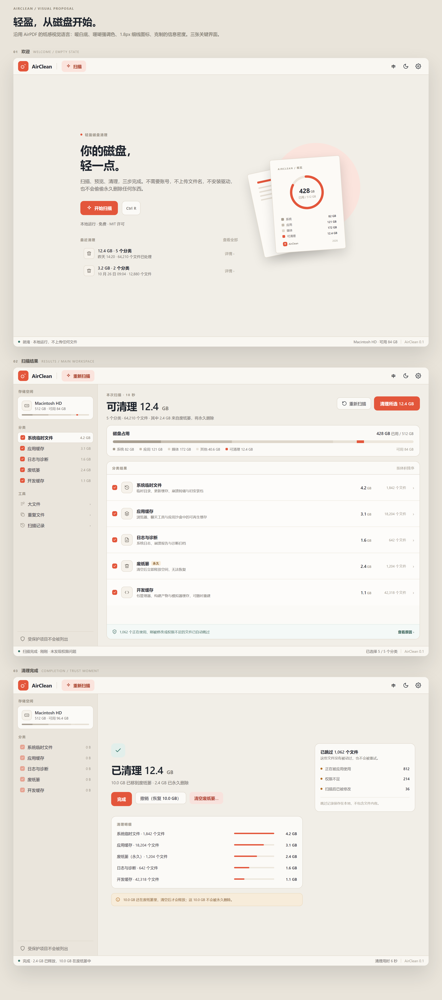

# AirClean 设计与技术方案

> 版本 v0.1 草案 · 2026-10-31
> 配套视觉稿：[design/mockup.png](design/mockup.png)（可编辑源：[design/mockup.html](design/mockup.html)）
> 参照实现：[AirPDF](https://github.com/RyzenWang/AirPDF)（.NET 10 + Avalonia 11）

---

## 0. 摘要

AirClean 是 Air 系列的第二款桌面软件：一款**免费、离线、跨平台**的磁盘清理工具，定位与 AirPDF 一致——本地运行、无账号、无广告、无遥测、界面克制。

视觉上**不另起炉灶**：直接复用 AirPDF 的设计令牌（暖纸底 `#F1EEE7`、珊瑚红 `#E3563B`、Inter + 中文回退、1.8px 细线图标、14px 圆角卡片），只新增一层"容量语义色"（安全/注意/危险、磁盘占用分段色）。

技术上沿用同一套栈：**.NET 10 + Avalonia 11 + CommunityToolkit.Mvvm + Velopack**，拆成 `AirClean.Core`（无 UI 扫描/删除引擎）、`AirClean.Platform`（Windows/macOS/Linux 适配）、`AirClean.App`（界面）三层。核心竞争力不是"能删多少"，而是**删得可信**：默认进废纸篓、逐项可预览、删除前复检、跳过项必须解释、绝不虚报可释放空间。

v0.1 范围：快速扫描 + 5 个安全分类（含废纸篓清空）+ 大文件 + 撤销/日志 + 中英双语。v1.0 补齐重复文件、提权助手、平台深度项。

---

## 1. 产品定位

### 1.1 一句话

> **AirClean —— 你的磁盘，轻一点。**

扫描、预览、清理，三步完成。不需要账号，不上传文件名，不安装驱动，也不会偷偷永久删除任何东西。

### 1.2 家族关系

| | AirPDF | AirClean |
| --- | --- | --- |
| 动词 | 读 | 清 |
| 承诺 | 打开得快，安静地退到后面 | 扫得准，删得可撤销 |
| 主标语 | 你的 PDF，轻一点。 | 你的磁盘，轻一点。 |
| 强调色 | 珊瑚红 `#E3563B` | 同左（品牌识别） |
| 辅助色 | 青绿 `#2E6F63`（少量） | 青绿 = 安全/完成；琥珀 = 注意；砖红 = 危险 |
| 版式 | 顶栏 50 + 侧栏 252 + 状态栏 30 | 完全一致 |
| 技术 | .NET 10 / Avalonia 11 / Velopack | 完全一致 |

两款产品的截图放在一起应当像同一个设计师在同一天做的：同样的留白、同样的圆角、同样的图标线条、同样的"一条 30px 状态栏"。

### 1.3 五条设计原则

1. **可信优先于高效。** 宁可多点一次确认，也不做"一键静默删除"。清理软件最贵的资产是信任。
2. **默认只勾安全的。** 有风险、会掉数据的分类（开发缓存里的 `node_modules`、下载目录的大文件、iOS 备份）默认不勾选。
3. **说清楚"现在还没释放"。** 移到废纸篓不等于释放空间。AirClean 会明说，并给"清空废纸篓"作为独立动作。
4. **不制造焦虑。** 不用红色感叹号、不虚报体积、不把 10 个分类的体积重复相加、不做"注册表错误 1,204 个"。
5. **克制。** 一屏一个主按钮；强调色只给"可清理"和"主操作"；动效只用于解释状态变化。

### 1.4 明确不做

- 注册表清理、"系统优化"、内存加速、驱动更新
- 浏览器历史/密码/隐私擦除
- 文件粉碎机（shredder）、数据恢复
- 云端同步、账号体系、任何遥测或广告
- 自动后台删除（最多做"提醒可以清理了"，且默认关闭）

---

## 2. 信息架构

### 2.1 主流程

```
欢迎页 ──开始扫描──▶ 扫描中（流式出结果）──▶ 结果总览
                                              │
                        ┌─────────────────────┼─────────────────────┐
                        ▼                     ▼                     ▼
                    分类详情              大文件 / 重复文件        设置
                        │                     │
                        └────────┬────────────┘
                                 ▼
                          清理确认弹层（列出条目与体积）
                                 │
                    ┌────────────┴────────────┐
                    ▼                         ▼
              移到废纸篓（默认）          永久删除（显式勾选）
                    │                         │
                    └────────────┬────────────┘
                                 ▼
                          完成页（可撤销 / 跳过报告）
```

### 2.2 界面清单

| # | 界面 | 优先级 | 说明 |
| --- | --- | --- | --- |
| 1 | 欢迎 / 空状态 | P0 | 品牌时刻 + 最近清理记录，复用 AirPDF 的 hero 结构 |
| 2 | 扫描中 | P0 | 环形进度 + 实时计数 + 已发现分类逐条浮出 + 取消 |
| 3 | 结果总览 | P0 | 左栏分类勾选，右栏容量卡 + 分类结果，主按钮"清理所选" |
| 4 | 分类详情 | P1 | 条目列表（虚拟化），按大小/时间排序，可单项取消勾选 |
| 5 | 大文件 | P1 | 表格视图，Top 200/卷，可"在文件夹中显示" |
| 6 | 重复文件 | P2 | 分组视图，默认保留策略可改，绝不自动勾选 |
| 7 | 清理确认 | P0 | 520px 弹层：分类汇总、删除方式、永久删除二次确认 |
| 8 | 完成页 | P0 | 已清理体积、撤销、清空废纸篓、跳过原因 |
| 9 | 设置 | P1 | 扫描范围/排除项、删除方式、语言、主题、更新 |
| 10 | 跳过报告 | P2 | 按原因分组的只读列表，可导出 |

### 2.3 关键交互规则

- **扫描范围**：默认"快速扫描"= 已知缓存位置 + 废纸篓 + 日志；"扫描整个磁盘"是显式选择，且预估耗时。
- **默认勾选**：`safe` 分类全选；`caution` 分类不选；`大文件/重复文件` 永不预选。`废纸篓` 默认勾选——勾它的语义就是"清空"，确认弹层会单独标注"永久删除"。
- **分类勾选 = 全选该类**：类内可进详情逐项取消，取消后分类变成半选（indeterminate）。
- **清理按钮上的数字永远等于当前勾选合计**，不是"发现了多少"。
- **取消**：扫描中取消立即停止，已发现结果保留可查看。
- **Esc** 关闭弹层/取消扫描；**Ctrl+R** 重新扫描；**Ctrl+,** 设置。
- **键盘可达**：分类列表支持 ↑↓ + Space 勾选，Tab 顺序为 侧栏 → 内容 → 主操作。

---

## 3. 视觉设计



### 3.1 设计令牌（继承 AirPDF，新增标记 ★）

| 类别 | 令牌 | Light | Dark | 用途 |
| --- | --- | --- | --- | --- |
| 背景 | `AppBackgroundBrush` | `#F1EEE7` | `#13171C` | 窗口底色（暖纸） |
| 背景 | `ToolbarBackgroundBrush` | `#F9F7F2` | `#181D23` | 顶栏、状态栏 |
| 背景 | `SidebarBackgroundBrush` | `#EAE5DC` | `#171C22` | 左栏 |
| 表面 | `SurfaceBrush` | `#FBFAF7` | `#1C222A` | 卡片 |
| 表面 | `SurfaceAltBrush` | `#F6F2EB` | `#202831` | 图标底板 |
| 边框 | `BorderBrush` | `#DED7CB` | `#2C343E` | 1px 分隔 |
| 边框 | `BorderStrongBrush` | `#C7BEB0` | `#43505D` | 输入框 hover |
| 文字 | `TextPrimaryBrush` | `#1D232C` | `#F3EFE6` | 标题、数字 |
| 文字 | `TextSecondaryBrush` | `#69645C` | `#ABA49A` | 正文说明 |
| 文字 | `TextTertiaryBrush` | `#9A9286` | `#7B756D` | 元信息（≥11px） |
| 强调 | `AccentBrush` | `#E3563B` | `#FF6B4E` | 主按钮、可清理 |
| 强调 | `AccentSoftBrush` | `#FBE4DD` | `#3A241F` | 软按钮底 |
| 强调 | `AccentTextBrush` | `#A93620` | `#FF9E8A` | 软按钮文字 |
| ★安全 | `SafeBrush` | `#2E6F63` | `#69B3A4` | 已保护/已完成/跳过说明 |
| ★安全 | `SafeSoftBrush` | `#E2EFEB` | `#1E312E` | 安全提示条 |
| ★注意 | `CautionBrush` | `#B26B1F` | `#D9A35A` | 不可撤销/需谨慎 |
| ★注意 | `CautionSoftBrush` | `#F7ECDA` | `#33291B` | 提示条底色 |
| 危险 | `DangerBrush` | `#B23A2B` | `#FF8E79` | 永久删除（AirPDF 已有） |
| 危险 | `DangerSoftBrush` | `#F8E2DD` | `#39221F` | 危险按钮底（AirPDF 已有） |
| ★容量 | `CapacitySystem` | `#A79E90` | `#5A6570` | 系统占用段 |
| ★容量 | `CapacityApps` | `#C7BEB0` | `#47525D` | 应用占用段 |
| ★容量 | `CapacityMedia` | `#DED7CB` | `#38424C` | 媒体占用段 |
| ★容量 | `CapacityOther` | `#E8E2D7` | `#2E3740` | 其他占用段 |
| ★容量 | `CapacityFree` | `#EDE7DD` | `#232A32` | 可用空间（轨道） |

> 容量分段刻意使用**同一色相的低饱和梯度**，只有"可清理"用珊瑚红。这样一条占用条里，红色永远等于"你能拿回来的"，不需要图例也能读懂。

### 3.2 字体与排版

| 角色 | 字号 / 行高 | 字重 | 字距 | 用途 |
| --- | --- | --- | --- | --- |
| `h1` | 35 / 44 | 600 | −0.8 | 欢迎页两行标题 |
| `h2` | 31 / 38 | 600 | −0.7 | "可清理 12.4 GB" |
| `h3` | 15 / 22 | 600 | −0.2 | 卡片标题 |
| `body` | 14 / 22 | 400 | 0 | 引导文案 |
| `ui` | 12.5 | 500 | 0 | 按钮、列表主文本 |
| `caption` | 11.5 | 400 | 0 | 说明、副标题 |
| `eyebrow` | 10 | 700 | +1.3 | 全大写小标签 |
| `mono-num` | 13 / 19 | 600 | 0 | 所有体积数字，`tabular-nums` |

字体栈：`Inter, Segoe UI, Microsoft YaHei UI, Noto Sans CJK SC, PingFang SC, sans-serif`，Inter 随包内嵌（与 AirPDF 同一份）。

**数字规则**：体积统一十进制（1 GB = 10⁹ B），保留 1 位小数；小于 1 GB 用 MB，小于 1 MB 用 KB，0 显示 `0 B`。数字用 `TextPrimaryBrush`，单位用小一号 `TextTertiaryBrush`，二者基线对齐。**不要**把单位写成 "G"、"GBs" 或加千位空格。

### 3.3 布局网格

```
1240 × 860（默认），最小 920 × 620
┌──────────────────────────────────────────────────────────┐
│ 顶栏 50px：logo 31 / 名称 15.5 / 分隔线 / 软按钮 34        │
├─────────────┬────────────────────────────────────────────┤
│ 左栏 252px  │ 内容区 padding 24–26                        │
│             │                                            │
│ 存储空间     │   eyebrow + h2 + 副标题      右侧操作按钮     │
│ 分类 5 行    │   ┌ 容量卡 14px 圆角 ──────────────────┐    │
│ 工具 3 行    │   └────────────────────────────────────┘    │
│             │   ┌ 分类结果卡（行高 57–78 自适应）──────┐    │
│ 底部安全说明 │   └────────────────────────────────────┘    │
├─────────────┴────────────────────────────────────────────┤
│ 状态栏 30px：● 状态 · · · · · · · · · · · 右对齐元信息      │
└──────────────────────────────────────────────────────────┘
```

- 间距基准 4px；卡片内 16–20；页面边距 24–26；卡片间距 14–16。
- 圆角：按钮 8–10，图标底板 9，卡片 14，弹层 16。
- 阴影**只**用于插画、弹层、确认对话框；普通卡片用 1px 边框，与 AirPDF 一致。
- 主内容最大宽度 1120，窗口更宽时居中留白，不拉伸行高。

### 3.4 组件规范

**分类行**（结果页核心组件）

```
[勾选 15]  [图标 34]  名称 + 一行说明（1fr）          体积 76 右  [条目数 92 右]  [› 12]
```

- 高度 57–78 自适应；hover 底色 `SurfaceHoverBrush`；选中行底 `#FDFCFA`（近白，不用强调色，避免整屏发红）。
- 勾选框 15px / 圆角 4.5 / 选中珊瑚红 + 白色对勾；半选显示横杠。
- 条目数超过 99,999 时显示 `120,000+`。

**容量条**

- 高 8px，圆角 4，轨道 `#EDE7DD`，分段之间无间隙。
- 段宽按真实字节比例，最小可见宽度 2px（小于 2px 的分段并入"其他"）。
- hover 某段时该段上方浮出 `应用 · 121 GB` 小标签；点击跳到对应分类。
- 图例在条下方一行，10.5px，圆点 7px。

**环形扫描进度**

- 直径 112（卡片内）/ 180（扫描页）；描边 7；轨道 `#EDE7DD`；进度珊瑚红、圆角端点。
- 中心：主数字 19px + 单位 10px + 一行说明 8.5px。
- 进度条**只表示真实进度**（已扫描字节 / 计划字节）；未知总量时改为不确定态（弧线来回扫，2.4s 循环）。

**清理确认弹层**

| 元素 | 规范 |
| --- | --- |
| 宽度 | 520，圆角 16，遮罩 `#660D1117` |
| 标题 | "清理 12.4 GB？" h3 |
| 汇总 | 5 行分类；废纸篓行带 `永久` 标签 |
| 说明段 | 琥珀底两行：`10.0 GB 移到废纸篓，可恢复` / `2.4 GB 来自废纸篓，清空后不可恢复` |
| 主按钮 | "清理 12.4 GB" |
| 次按钮 | "取消" 文本按钮 |
| 可选 | 勾选"不经过废纸篓，直接永久删除"后，按钮变 `DangerBrush`、文案变"永久删除 12.4 GB" |
| 页脚 | 一行 `SafeSoft` 说明：正在使用的文件会自动跳过 |

**空状态 / 错误态**

- 空状态：42px 圆角图标底板 + 一行 `caption`，与 AirPDF "无目录"一致。
- 错误：`DangerSoft` 条 + 一句人话（"这个位置需要管理员权限"），永远给下一步动作。

### 3.5 图标与品牌

- **线条图标**：继续用 Lucide（ISC），`stroke-width: 1.8`，`stroke-linecap: round`，默认 18px，小号 15px。新增：`disk`、`sparkle`、`trash-2`、`layers`、`file-text`、`code`、`shield-check`、`hard-drive`。
- **应用图标**：珊瑚红圆角方块（31×31，圆角 8）+ 白色"磁盘 + 星芒"字形——圆盘代表存储，星芒代表清理。与 AirPDF 的纸飞机同为"简单几何线条 + 一点实心装饰"。
- **标语系统**：
  - 主：你的磁盘，轻一点。
  - 副：清掉多余的，留下重要的。
  - 元信息：本地运行 · 免费 · MIT 许可。

### 3.6 动效

| 场景 | 时长 / 曲线 | 说明 |
| --- | --- | --- |
| 按钮/行 hover | 120ms ease-out | 只变背景色 |
| 卡片/面板出现 | 180ms cubic-bezier(.2,.7,.3,1) | 位移 6px + 透明度 |
| 扫描环 | 600ms ease-out 追赶真实进度 | 不做假循环（除不确定态） |
| 数字滚动 | 400ms ease-out | 只在完成页做一次 |
| 删除行消失 | 150ms | 先变灰再收起高度 |
| 遵循"减少动态效果" | 全部降级为瞬时 | 读系统设置 |

### 3.7 无障碍

- 对比度：正文 `#1D232C`/`#F1EEE7` ≈ 12.6:1；次要 `#69645C` ≈ 5.0:1；`#9A9286` ≈ 2.8:1 **仅用于 ≥11px 的元信息**，不承载关键信息。
- 焦点环：2px `AccentBrush`，offset 2，键盘可见、鼠标不可见。
- 所有图标按钮有 `ToolTip` + `AutomationProperties.Name`。
- 体积数字同时提供可读文本（"12.4 GB"→ 屏幕阅读器读"12.4 GB"，不要拆成两个 TextBlock）。
- 扫描完成、清理完成用 `AutomationProperties.LiveSetting` 播报。

---

## 4. 技术实现方案

### 4.1 选型与理由

| 层 | 选择 | 理由 |
| --- | --- | --- |
| 运行时 | .NET 10 (LTS) | 与 AirPDF 一致；`FileSystemEnumerable`、`Parallel.ForEachAsync`、单文件发布成熟 |
| UI | Avalonia 11.3.22 | 一套 XAML 三平台；可直接复用 AirPDF 的样式与控件写法 |
| MVVM | CommunityToolkit.Mvvm 8.4.2 | 源生成、轻量；与 AirPDF 同版本 |
| 打包 | Velopack 1.2.161 | 与 AirPDF 同一套 CI 与自动更新 |
| Windows Shell | Microsoft.Windows.CsWin32 | 源生成 `IFileOperation`、`SHEmptyRecycleBin`，避免手写 P/Invoke |
| 快哈希 | System.IO.Hashing (XxHash64) | 重复文件预筛，比 SHA-256 快一个数量级 |
| 测试 | xUnit + 临时目录 fixture | 引擎必须可无 UI 测试 |

**为什么不选其他方案**

| 方案 | 否决理由 |
| --- | --- |
| WPF / WinUI 3 | 只覆盖 Windows，违背"跨平台"定位 |
| Electron | 安装包 100MB+、常驻内存高，与"轻"直接冲突 |
| Tauri | 包小，但扫描/删除引擎仍需原生代码；macOS/Linux WebView 行为不一；与 AirPDF 技术栈割裂，无法共享样式与经验 |
| Rust + egui | 包小、性能好，但 UI 精细度与中文排版成本高，团队连续性差 |

结论：**沿用 AirPDF 的栈，把精力放在引擎的安全性与平台的差异处理上。**

### 4.2 解决方案结构

```
AirClean.sln
src/
  AirClean.Core/                 # 无 UI、无平台 API 直接调用
    Models/                      # CleanItem, CleanCategory, ScanCounters, Safety
    Rules/                       # ScanRule, RuleSet, RuleValidator, GlobMatcher
    Scanning/                    # Scanner, ScanSession, ScanPlan, RootWalker
    Deleting/                    # DeletionService, DeletionPlan, Journal, UndoService
    Duplicates/                  # DuplicateFinder, HashPipeline
    Volumes/                     # VolumeInfo, VolumeService
    Settings/                    # SettingsService (JSON, 原子写)
    Abstractions/                # ITrashService, IFileIdentity, IVolumeProbe, IElevationBroker
  AirClean.Platform/             # 平台适配：单项目 net10.0 + 按 OS 分目录，运行时 OperatingSystem.Is* 分发，P/Invoke 用 #if WINDOWS 隔离
    Windows/                     # ShellTrash, FileId (FILE_ID_INFO), RecycleBin, HelperClient
    MacOs/                       # NSFileManager Trash, 容器路径, TCC 检测
    Linux/                       # freedesktop Trash, XDG 目录, journalctl/apt 适配
  AirClean.Helper/               # 可选提权助手（console，独立 exe）
  AirClean.App/                  # Avalonia 应用
    Views/ ViewModels/ Styles/ Assets/ Services/
tests/
  AirClean.Core.Tests/
  AirClean.Platform.Tests/
docs/
  design/                        # 视觉稿
  ARCHITECTURE.md
```

**依赖方向**：`App → Core + Platform`，`Platform → Core.Abstractions`，`Core` 不引用 `Platform`。这样扫描与删除规则可以在 Linux CI 上跑单元测试。

**关于"家族复用"**：目前只有两款产品，先各自复制 `Styles/`；当出现第三款 Air 应用时，把 `Colors.axaml / Controls.axaml / Icons.axaml / LocalizationService / SettingsService` 抽成 `Air.UI` 共享包（或 git submodule）。现在抽象共享库的收益低于维护成本。

### 4.3 扫描引擎

#### 分层

```
ScanPlan（规则集合 + 范围 + 深度）
   │
   ├─ RootWalker ×N   （每根目录一个异步 DFS）
   │      ├─ 跳过 reparse point / 挂载点
   │      ├─ 匹配规则（glob + 深度 + 文件年龄）
   │      └─ 产出 CleanItem → 有界 Channel(8192)
   │
   └─ Aggregator（单消费者）
          ├─ 分类计数 / 体积直方图
          ├─ 每 2,000 条或 100ms 调用 sink.OnItems
          └─ 进度节流到 8–10 Hz
```

#### 关键决策

1. **`FileSystemEnumerable` + 手写栈**，不用 `Directory.GetFiles(AllDirectories)`：
   - 需要逐目录控制深度、跳过 reparse point、跳过挂载点、精确计数。
   - `EnumerationOptions { IgnoreInaccessible = true, RecurseSubdirectories = false, AttributesToSkip = 0 }`。
   - `AttributesToSkip = 0` 是必须的：临时文件和缓存经常是 Hidden/System，默认会被跳过。
2. **不跟随链接**：`FileAttributes.ReparsePoint`（Windows）与 `FileSystemInfo.LinkTarget != null`（Unix）一律跳过目录递归；若规则目标是链接本身，只删链接。
3. **并发**：`Parallel.ForEachAsync(roots, MaxDegreeOfParallelism = Clamp(ProcessorCount / 2, 2, 8))`。SSD 上 4–8 路最优，机械盘 2 路。
4. **背压**：`Channel.CreateBounded(8192, FullMode = Wait)`，防止 2M 文件时内存爆掉。
5. **聚合内存上限**：每个分类最多物化 `2,000` 条 `CleanItem`；超出只累计数量/体积，并保留体积直方图（用于详情页分布图）。1M 文件时内存约 250MB → 压到 120MB 以内。
6. **超长路径**：Windows 上统一 `\\?\` 前缀规范化；`Path.GetFullPath` 之后再拼接，避免 260 限制。
7. **不阻塞 UI**：所有 IO 在 `Task.Run` / 线程池；`ObservableCollection` 只在 UI 线程改。

#### 接口草案

```csharp
namespace AirClean.Core.Scanning;

public enum ScanPhase { Preparing, Walking, Hashing, Aggregating, Completed, Canceled, Failed }

public readonly record struct ScanCounters(
    long FilesSeen, long DirectoriesSeen, long BytesSeen,
    long ItemsFound, long BytesFound, long ItemsSkipped, TimeSpan Elapsed);

public interface IScanSink
{
    ValueTask OnItemsAsync(ReadOnlyMemory<CleanItem> items, ScanCounters counters, CancellationToken ct);
    ValueTask OnPhaseAsync(ScanPhase phase, string? detail, CancellationToken ct);
}

public sealed class Scanner(RuleSet rules, IFileIdentity identity)
{
    public Task<ScanResult> RunAsync(ScanPlan plan, IScanSink sink, CancellationToken ct);
}
```

```csharp
public sealed class CleanItem
{
    public required string Path { get; init; }
    public required string RuleId { get; init; }
    public required CleanCategory Category { get; init; }
    public required Safety Safety { get; init; }
    public required long Size { get; init; }
    public required DateTime LastWriteUtc { get; init; }
    public FileAttributes Attributes { get; init; }
    public int Depth { get; init; }
    public bool IsDirectory { get; init; }
}
```

#### 进度语义

- 有明确总量（规则声明的根可预估）→ 确定态。
- 无总量（整盘遍历）→ 只显示"已扫描 128,400 个文件 · 已找到 4.8 GB"，**不显示百分比**。宁可没有进度条，也不给假进度。

#### 结果物化与详情分页

- 分类总览只存"计数 + 体积 + 尺寸直方图"，不存路径。
- 详情页每类最多物化 2,000 条；超出部分显示"另有 12,408 个同类文件（合计 3.2 GB）"，操作按规则整体处理，不逐条列出。
- 这样 100 万文件时 UI 行数恒定，内存与渲染都可控。

#### 卷

- 枚举：Windows 用 `DriveInfo`；macOS 用 `/` + `/Volumes/*`；Linux 解析 `/proc/mounts`，过滤 `tmpfs` / `devtmpfs` / `overlay` 等伪文件系统。
- 多卷时左栏顶部可切换；默认扫描系统卷与家目录所在卷。
- **跨卷进废纸篓 = 复制 + 删除**，慢且容易失败。规则根与废纸篓不同卷时，默认改为"永久删除"并在确认弹层里明确说明。

### 4.4 规则模型

规则是**数据**，不是代码。随包内嵌 JSON（按平台分文件），启动时校验，任何不合法的规则直接拒绝加载。

```json
{
  "id": "mac.app-caches",
  "platform": "macos",
  "category": "app-cache",
  "safety": "safe",
  "roots": ["~/Library/Caches"],
  "include": ["*"],
  "exclude": ["com.apple.*", "CloudKit"],
  "recurse": true,
  "maxDepth": 2,
  "minAgeDays": 2,
  "action": "contents",
  "source": "Apple 官方缓存目录；应用重建成本低"
}
```

| 字段 | 说明 |
| --- | --- |
| `roots` | 支持 `~`、`%VAR%`、`$VAR`；展开后必须为绝对路径 |
| `include/exclude` | 简单 glob（`FileSystemName.MatchesSimpleExpression`），只匹配文件名 |
| `recurse/maxDepth` | 深度硬上限 8 |
| `minAgeDays` | 只清理 N 天前修改的文件，避开"刚生成还在用"的缓存 |
| `action` | `contents`（清空目录内容）/ `matched`（只删匹配项）/ `tree`（整棵删）/ `empty-trash` |
| `safety` | `safe` 默认勾选；`caution` 默认不勾；`protected` 只读展示 |
| `requiresElevation` | 该规则需要提权助手执行 |
| `source` | 人写的"为什么安全"，code review 必读，同时显示在详情页 |

**启动校验（`RuleValidator`）**

- 根目录不得是：盘符根、`/`、`$HOME` 本身、`C:\Windows` 整体、`/System`、`/usr`、`/etc`、`~`、`~/Documents`、`~/Desktop`、`~/Pictures` 等受保护路径。
- 根目录必须存在，否则跳过并记录（不报错）。
- 同一规则内 `include` 不得为 `**` 且 `maxDepth = 0` 且 `action = tree`（等价于删根）。
- 规则 id 唯一；`category` 必须在枚举内。

### 4.5 安全模型

这是整个产品的核心，写成**可测试的不变量**：

| # | 不变量 | 实现 |
| --- | --- | --- |
| S1 | 只能删规则根目录之下的路径 | `PathGuard.IsUnder(root, path)`，用 `Path.GetRelativePath` 判断，`..` 与绝对路径一律拒绝 |
| S2 | 受保护路径永不可删 | `ProtectedPaths` 硬拒绝表，优先级高于任何规则 |
| S3 | 不跟随符号链接 / junction / 挂载点 | 遍历与删除两侧都检查 `ReparsePoint` / `LinkTarget` |
| S4 | 删除前复检 | 重新 `stat`，`Size` 或 `LastWriteUtc` 变化则跳过（扫描后被改过） |
| S5 | 目录只在空的时候删 | 自底向上清理空目录，失败静默跳过 |
| S6 | 单点删除入口 | 规则/扫描代码里禁止出现 `File.Delete`，由架构测试扫描源码强制 |
| S7 | 提权助手只接受规则 id | 助手自己重新执行规则并复检，从不接受任意路径 |
| S8 | 不删用户内容 | 文档/桌面/图片/下载目录只出现在"大文件/重复文件"的**只读**列表中 |

```csharp
public static class PathGuard
{
    public static bool IsUnder(string root, string path)
    {
        var r = Path.TrimEndingDirectorySeparator(Path.GetFullPath(root));
        var p = Path.TrimEndingDirectorySeparator(Path.GetFullPath(path));
        var rel = Path.GetRelativePath(r, p);
        return rel != "." &&
               !rel.StartsWith("..", StringComparison.Ordinal) &&
               !Path.IsPathRooted(rel);
    }

    public static string RequireUnder(string root, string path) =>
        IsUnder(root, path) ? path : throw new SafetyViolationException(root, path);
}
```

**受保护路径（硬编码，规则不可覆盖）**

```
Windows: C:\  C:\Windows\System32  C:\Windows\SysWOW64  C:\Windows\WinSxS
         C:\Program Files*  %USERPROFILE%  %USERPROFILE%\Desktop|Documents|Pictures
macOS:   /  /System  /Library/Extensions  /usr  /bin  /sbin  /etc  ~  ~/Desktop|Documents|Pictures
Linux:   /  /usr  /bin  /sbin  /etc  /boot  /dev  /proc  /sys  ~  ~/Desktop|Documents|Pictures
通用:    ~/.ssh  ~/.gnupg  ~/.git  ~/.config  （以及路径中任一段为 .git 的目录）
```

匹配规则要分两级，否则 `~/Library/Caches` 会被 `~` 误伤：

- **只拒绝"等于"**：`/`、`C:\`、盘符根、`~`、`$HOME` —— 这些目录本身不可删，但其下的具体缓存目录是允许的。
- **拒绝"等于或位于其下"**：`C:\Windows\System32`、`/usr`、`/etc`、`~/Documents`、`~/Desktop`、`~/Pictures`、`~/.ssh` —— 整棵子树都不可删。

### 4.6 删除与撤销

#### 流程

```
用户勾选 → DeletionPlan（按规则聚合，不是按路径）
   → 确认弹层 → DeletionService.ExecuteAsync
        对每个条目：
          1. PathGuard（S1/S2）
          2. 复检 size + mtime（S4）
          3. 跳过 reparse point（S3）
          4. ITrashService.MoveToTrash | File.Delete | EmptyTrash
          5. 失败按原因归类：InUse / Permission / Changed / NotFound
          6. 记录恢复位置（若有）
        7. 写 journal（每批一个 JSON 文件）
        8. 自底向上清理空目录
```

#### 删除方式

| 模式 | Windows | macOS | Linux |
| --- | --- | --- | --- |
| 移到废纸篓（默认） | `IFileOperation` + `FOF_ALLOWUNDO`（CsWin32） | `NSFileManager.trashItemAtURL:resultingItemURL:` | freedesktop Trash 规范：`$XDG_DATA_HOME/Trash/{files,info}` + `.trashinfo` |
| 永久删除（需勾选） | `File.Delete` / `Directory.Delete` | 同左 | 同左 |
| 清空废纸篓（废纸篓类目） | `SHEmptyRecycleBin` | 清空 `~/.Trash` | 清空 Trash `files/info` |

**批次内按条目决定删除方式。** 普通分类走"移到废纸篓"，废纸篓分类走"清空"（永久）。两者可以在同一批里执行，但结果必须分开报告：完成页同时显示"已释放 2.4 GB"与"10.0 GB 在废纸篓中"，而不是把 12.4 GB 全部说成"已释放"。顺序固定为**先清空废纸篓，再移入新文件**，避免把本批刚移入的文件当场清掉。

**关于撤销，要说实话**：

| 平台 | 能否应用内撤销 | 原因 |
| --- | --- | --- |
| macOS | ✅（主卷） | journal 记录移入后的路径，恢复时直接移回；`NSFileManager` 与外置卷 `.Trashes` 仍待补 |
| Linux | ✅ | journal 路径优先，缺失时读 `info/*.trashinfo` 并按原始路径匹配 |
| Windows | ✅ | 按原路径解析 `$Recycle.Bin\<SID>\$I*`，定位对应 `$R` 后移回；长路径仍受删除路径限制 |

**实现必须如实报告**：部分失败、目标已存在、原目录缺失、回收站已被清空，都要在完成页上写清楚，不能给一个点了没反应的"撤销"按钮。

#### Journal

`%APPDATA%\AirClean\journal\<yyyy-MM>\<utcTicks>-<batchId>.json`，每批一个文件，
先写 `.tmp` 再原子改名：

```json
{"v":2,"batchId":"…","at":"2026-10-31T06:20:11Z","mode":"trash","canceled":false,
 "deleted":64210,"trashedBytes":12400000000,"freedBytes":0,
 "skipped":{"inUse":812,"permission":214},
 "items":[{"p":"/Users/me/Library/Caches/com.x/y.bin","s":1048576,
           "r":"/Users/me/.Trash/y.bin","restored":false}]}
```

- 保留 30 天 / 200 批次，超过滚动删除；撤销成功后只更新该批次文件。
- 只记路径、体积与回收站位置，不记文件内容；全部留在本机。
- 供"最近清理"与撤销使用，也是"跳过报告"与"扫描记录"的数据源。
- 0.2 及更早的 `journal/yyyy-MM.jsonl` 仍可读取：只能作为历史查看，不能撤销。

#### 失败处理

- `IOException` / `UnauthorizedAccessException` → 归类跳过，不中断整批。
- 磁盘满导致移入废纸篓失败 → 提示"空间不足，无法移到废纸篓"，提供"直接永久删除"选项（二次确认）。
- 单批失败超过 30% → 自动中止并报告，避免在错误状态下持续删除。

### 4.7 大文件与重复文件

**大文件**：遍历时维护每卷的 `PriorityQueue`（容量 200），O(n log 200)，不额外扫盘。只读列表，默认不勾选。列表项提供"在资源管理器/访达中显示"（`Process.Start` + shell 选择）。

**重复文件**：

1. 只扫用户内容目录（文档/下载/图片/影片/桌面），跳过系统目录与 `node_modules`。
2. 按 `Size` 分桶，`Size < 1 MB` 不参与（收益低于打扰）。
3. 桶内 >1 才做**头部 64 KB 的 XxHash64**。
4. 头部相同才做**全文件 SHA-256**（1 MiB 流式缓冲，并行度 = 2）。
5. 结果按 hash 分组；组内默认建议"保留修改时间最早的一份"，但**永远不自动勾选**。
6. 硬链接去重：Windows 用 `GetFileInformationByHandleEx(FileIdInfo)` 识别；macOS/Linux v0.1 不处理（用户目录中罕见），文档中注明。
7. APFS 克隆（clone）会表现为"两个文件、共享块"，删除其一不释放空间 —— 详情页加一行说明，避免"我删了怎么没变"。

### 4.8 平台差异矩阵

| 分类 | Windows | macOS | Linux |
| --- | --- | --- | --- |
| 系统临时 | `%TEMP%`、`%LOCALAPPDATA%\Temp`、`C:\Windows\Temp` | `$TMPDIR`、`/private/var/folders/.../T` | `/tmp`、`/var/tmp`（限 1 天前） |
| 应用缓存 | 浏览器 `Cache/Code Cache/GPUCache`、`%LOCALAPPDATA%\Packages\*\LocalCache` | `~/Library/Caches/*`、`~/Library/Containers/*/Data/Library/Caches`（需完全磁盘访问） | `~/.cache/*`、`~/.cache/thumbnails` |
| 日志诊断 | `%LOCALAPPDATA%\CrashDumps`、`WER`、`CBS` 日志 | `~/Library/Logs`、DiagnosticReports | `~/.cache/*.log`、`/var/log/journal`（`journalctl --vacuum`，需 root） |
| 废纸篓 | `$Recycle.Bin`（`SHEmptyRecycleBin`） | `~/.Trash` | `~/.local/share/Trash` |
| 开发缓存 | `%LOCALAPPDATA%\NuGet\v3-cache`、`%LOCALAPPDATA%\Temp\NuGetScratch` | `~/Library/Caches/Homebrew`、Xcode `DerivedData`、`CoreSimulator/Caches` | `~/.npm/_cacache`、`~/.cache/pip`、`~/.gradle/caches`、`~/.cargo/registry/cache` |
| 系统更新残留 | `SoftwareDistribution\Download`、DeliveryOptimization（需管理员，可停服务） | 无（系统快照另说） | `apt` 缓存（需 root） |
| 只读建议项 | WinSxS 组件清理（`DISM /StartComponentCleanup`）、`hiberfil.sys`、系统还原点 | Time Machine 本地快照（`tmutil listlocalsnapshots`） | `/var/log` 归档、旧内核 |
| 特殊限制 | 长路径、文件占用、杀软锁文件 | TCC 权限、SIP、APFS 共享空间 | 权限、mount 命名空间、符号链接 |

**只读建议项**做成"操作卡"：说明体积、给出官方命令、提供"复制命令"按钮，**不在应用内执行**。这类系统级操作交给系统工具，比自研更安全。

### 4.9 权限与提权

- 主进程**永远不提权**（不显示 UAC 盾牌，不要求 sudo）。
- 需要管理员的规则（Windows Update 缓存、`/var/cache/apt`、`journalctl`）由 `AirClean.Helper` 执行：
  - 独立 exe，`app.manifest` 声明 `requireAdministrator`。
  - 通过 `ShellExecute(verb: "runas")` 启动，stdin/stdout 走行分隔 JSON。
  - 协议只接受 `ruleId` 列表，**不接受路径**；助手用自己内嵌的规则集重新匹配、重新校验、再删除。
  - 助手执行完必须恢复被暂停的服务（如 `wuauserv`），失败也要恢复，并回报。
- macOS 的"完全磁盘访问"：首次扫描检测到 `~/Library/Containers` 大量权限失败时，给一张卡片解释 + 深链到"系统设置 › 隐私与安全性 › 完全磁盘访问"，而不是弹错误。

### 4.10 性能预算

| 指标 | 目标 | 手段 |
| --- | --- | --- |
| 冷启动到可交互 | < 800 ms | 不预扫；Avalonia 启动与 AirPDF 同量级 |
| 快速扫描（~10 万文件） | < 5 s | 4–8 路并发 + 流式出结果 |
| 首次结果出现 | < 1.5 s | 按根目录排序，先扫小目录 |
| 全盘 50 万文件（NVMe） | 20–40 s | 背压 + 无分配遍历 |
| 重复文件 1 TB | < 3 min | 大小分桶 + 头部哈希 + 仅全量哈希候选 |
| 内存峰值 | < 250 MB | 分类物化上限 2,000 |
| 删除吞吐 | > 500 文件/s | 批量 `IFileOperation`；永久删除并行 4 路 |

**测量方式**：`Scanner` 内置 `Stopwatch` 分段计时，debug 构建输出到日志（不埋点、不上传）。

### 4.11 可观测性与隐私

- 本地日志：`%APPDATA%\AirClean\logs\airclean.log`，滚动 5 MB × 3，默认 `Info`，不记录文件名（只记分类与计数）。
- 无遥测、无崩溃上报、无网络请求（除安装版检查更新）。
- 设置里一个开关："记录详细日志（包含文件路径，仅本地）"，默认关。

---

## 5. 工程与交付

### 5.1 项目骨架

```xml
<!-- AirClean.Core.csproj -->
<Project Sdk="Microsoft.NET.Sdk">
  <PropertyGroup>
    <TargetFramework>net10.0</TargetFramework>
    <Nullable>enable</Nullable>
    <ImplicitUsings>enable</ImplicitUsings>
    <TreatWarningsAsErrors>true</TreatWarningsAsErrors>
  </PropertyGroup>
</Project>
```

```xml
<!-- AirClean.App.csproj -->
<PropertyGroup>
  <OutputType>WinExe</OutputType>
  <TargetFramework>net10.0</TargetFramework>
  <AssemblyName>AirClean</AssemblyName>
  <ApplicationIcon>Assets/airclean.ico</ApplicationIcon>
  <AvaloniaUseCompiledBindingsByDefault>true</AvaloniaUseCompiledBindingsByDefault>
</PropertyGroup>
<ItemGroup>
  <PackageReference Include="Avalonia" Version="11.3.22" />
  <PackageReference Include="Avalonia.Desktop" Version="11.3.22" />
  <PackageReference Include="Avalonia.Themes.Fluent" Version="11.3.22" />
  <PackageReference Include="Avalonia.Fonts.Inter" Version="11.3.22" />
  <PackageReference Include="CommunityToolkit.Mvvm" Version="8.4.2" />
  <PackageReference Include="Velopack" Version="1.2.161" />
</ItemGroup>
```

### 5.2 实施顺序（v0.1，按可演示的纵向切片）

| 阶段 | 内容 | 完成标准 |
| --- | --- | --- |
| M0（3–4 天） | 解决方案骨架、设计令牌、主窗口壳、设置/国际化/主题、Velopack 空壳 | 三平台能启动，浅/深色正确，切换语言即时生效 |
| M1（1 周） | 规则引擎 + 扫描器 + 3 个安全分类（临时/日志/废纸篓）+ 结果页 | Windows 上扫出真实体积，取消可用，UI 不卡 |
| M2（1 周） | 删除服务 + 废纸篓适配 + 完成页 + journal | macOS/Linux 可应用内还原；Windows 提供"打开回收站"；失败原因可见 |
| M3（1 周） | 其余分类（各平台）+ 大文件 + 跳过报告 + 确认弹层 | 三平台分类各自可用 |
| M4（4–5 天） | 大文件列表、扫描记录、设置页、跳过报告完善 | 大文件只读且不预选；设置在重启后保留 |
| M5（3–4 天） | CI 矩阵、打包、图标、README、首版发布 | GitHub Release 出 Setup.exe / pkg / tar.gz |

**0.2 起**：重复文件、提权助手（Windows Update / apt / journald）、Windows 回收站解析与真正撤销、定时提醒。

单人节奏约 **4–6 周** 到 0.1.0；两人并行可压到 3 周（一人引擎、一人 UI）。

### 5.3 测试策略

| 类型 | 内容 |
| --- | --- |
| 单元 | glob 匹配、路径守卫、体积格式化、规则校验、journal 序列化 |
| 安全 | `..` 逃逸、符号链接逃逸、junction 逃逸、根目录自身、受保护路径 —— 全部必须抛/拒绝 |
| 集成 | 临时目录 fixture：普通文件、隐藏文件、只读、符号链接、长路径、Unicode 文件名、锁定文件 |
| 扫描 | 固定 fixture 的计数/体积快照；取消后无残留任务；重复扫描结果稳定 |
| 删除 | 删除后校验、撤销还原、部分失败不影响其余、空目录清理不越界 |
| UI | Avalonia.Headless 冒烟：启动、扫描（假引擎）、勾选、确认弹层（v0.2 起） |
| 性能 | 生成 2 万个空文件的基准，回归阈值 ±20% |

安全测试是发布门禁：任何一条不变量测试失败，不上 Release。

### 5.4 打包与自动更新

与 AirPDF 完全一致：

- Windows：`vpk pack --packId AirClean --mainExe AirClean.exe --icon Assets/airclean.ico --channel win` → `AirClean-win-Setup.exe` + portable zip
- macOS：`--packId AirClean-osx-<arch>` → `.pkg` + portable，签名 + 公证
- Linux：`tar.gz`（deb/AppImage 留到 0.2）
- 自动更新：仅安装版；后台检查 GitHub Release，状态栏提示"重启以更新"（复刻 AirPDF 的 `UpdateService`）

### 5.5 风险与对策

| 风险 | 影响 | 对策 |
| --- | --- | --- |
| macOS TCC 导致大量缓存不可读 | 扫描结果偏少，用户觉得"没用" | 首次运行引导授权；跳过报告解释；文案不承诺"全部缓存" |
| 杀软/SmartScreen 误报 | 安装率暴跌 | 代码签名、开源、无混淆、不自我修改、不驻留后台 |
| 用户以为"清理完空间没变" | 信任崩塌 | 完成页明确"在废纸篓里"；提供清空入口；文案前置 |
| 删除正在使用的缓存 | 应用异常 | 文件锁捕获 + `minAgeDays` + 跳过原因展示 |
| 规则写错导致误删 | 灾难性 | S1–S8 不变量 + code review + fixture 测试 + 发布前 dry-run 报告 |
| Windows 更新缓存需停服务 | 失败率高 | 提权助手 + try/finally 恢复服务 + 失败回滚提示 |
| APFS 共享可用空间 | 数字困惑 | 显示容器级数据，脚注说明；不做精确到 GB 的承诺 |
| 扫描速度不达预期 | 口碑差 | 流式出结果优先于总时长；首屏 1.5s 内必须有内容 |

---

## 附录 A：核心类型速览

```csharp
public enum Safety { Safe, Caution, Protected }

public enum CleanCategory
{
    SystemTemp, AppCache, LogsDiagnostics, Trash, DeveloperCache,
    LargeFiles, Duplicates
}

public enum DeleteMode { Trash, Permanent }

public sealed record DeletionReport(
    Guid BatchId,
    long DeletedCount,
    long TrashedBytes,
    long FreedBytes,
    IReadOnlyDictionary<SkipReason, int> Skipped,
    IReadOnlyList<string> FailedSamples,
    bool CanUndo);

public enum SkipReason { InUse, Permission, ChangedSinceScan, NotFound, Protected, ReparsePoint }
```

## 附录 B：`Colors.axaml` 增量

```xml
<!-- 在 AirPDF 的 Colors.axaml 基础上追加；两个主题字典各一份 -->
<SolidColorBrush x:Key="SafeBrush" Color="#2E6F63" />
<SolidColorBrush x:Key="SafeSoftBrush" Color="#E2EFEB" />
<SolidColorBrush x:Key="CautionBrush" Color="#B26B1F" />
<SolidColorBrush x:Key="CautionSoftBrush" Color="#F7ECDA" />
<!-- DangerBrush / DangerSoftBrush 已存在 -->

<SolidColorBrush x:Key="CapacitySystemBrush" Color="#A79E90" />
<SolidColorBrush x:Key="CapacityAppsBrush" Color="#C7BEB0" />
<SolidColorBrush x:Key="CapacityMediaBrush" Color="#DED7CB" />
<SolidColorBrush x:Key="CapacityOtherBrush" Color="#E8E2D7" />
<SolidColorBrush x:Key="CapacityTrackBrush" Color="#EDE7DD" />
```

Dark 主题对应值见 3.1 表格。

## 附录 C：文案表（中/英）

| Key | 中文 | English |
| --- | --- | --- |
| `Welcome.Title1` | 你的磁盘， | Your disk, |
| `Welcome.Title2` | 轻一点。 | a little lighter. |
| `Welcome.Subtitle` | 扫描、预览、清理，三步完成。不需要账号，不上传文件名，也不安装驱动。 | Scan, preview, clean. No account, no uploads, no drivers. |
| `Scan.Start` | 开始扫描 | Start scan |
| `Scan.Cancel` | 取消扫描 | Cancel scan |
| `Scan.Found` | 已找到 {0} 可清理 | {0} reclaimable so far |
| `Results.Reclaimable` | 可清理 {0} | {0} to clean |
| `Results.Clean` | 清理所选 {0} | Clean {0} |
| `Confirm.TrashTitle` | 移到废纸篓？ | Move to Trash? |
| `Confirm.Permanent` | 永久删除，无法恢复 | Delete permanently, cannot be undone |
| `Done.Title` | 已清理 {0} | {0} cleaned |
| `Done.SpaceNote` | 还有 {0} 在废纸篓里，清空后才会释放。 | {0} is still in the Trash — it frees up when you empty it. |
| `Skip.Explain` | 正在使用、刚被修改或权限不足的文件已自动跳过 | Files in use, just modified, or without permission were skipped |

---

*本方案为 v0.1 草案，等待确认后进入 M0。*
